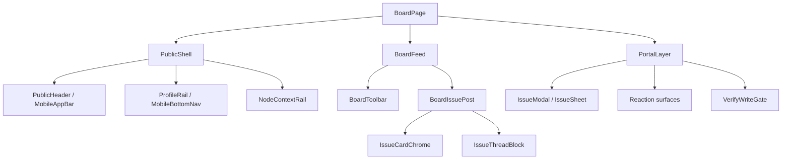

# DOGEstonia Component & Variants Specification v1.0

**Scope:** `/board`, `/issue/:id`, Issue social layer, responsive shell  
**Target:** shared Figma component library, React.js and Storybook  
**Themes:** light and dark  
**Status:** implementation handoff

## 1. Purpose

This document defines the canonical component architecture behind the approved DOGEstonia dashboard and thread mockups.

It standardizes:

- component names across design and code;
- ownership and composition boundaries;
- anatomy and slots;
- variant axes;
- visual and behavioral states;
- logical inputs and emitted events;
- responsive behavior;
- accessibility requirements;
- prohibited substitutions.

Logical inputs in this document are UI contracts, not gateway schemas. They must be adapted from approved domain data rather than copied into new API payloads.

## 2. Source hierarchy

When sources disagree, use this order:

1. product and architecture requirements;
2. Unified State Inventory;
3. this Component & Variants Specification;
4. Design Tokens Package;
5. Responsive Layout and Mobile Design packs;
6. generated visual mockups.

Latest approved revision wins within the same layer.

## 3. Naming across tools

| Layer | Convention | Example |
|---|---|---|
| Product/spec | PascalCase in backticks | `BoardIssuePost` |
| React | PascalCase export | `BoardIssuePost` |
| Figma set | Category / spaced name | `Board / Issue Post` |
| Storybook | Category/Component/Story | `Board/BoardIssuePost/ThreadLoading` |
| CSS/token block | kebab case | `doge-board-issue-post` |
| Test id | approved kebab identifier | `board-issue-post` |

Do not create different names for the same component in desktop and mobile libraries.

## 4. Component hierarchy



## 5. Ownership model

### 5.1 Page/container ownership

Page or feature containers own:

- data fetching and query lifecycle;
- routing and URL state;
- identity/permission resolution;
- normalization into view models;
- retry policy;
- overlay open/close state;
- server-confirmed reaction/comment state;
- preserving return and scroll context.

### 5.2 Presentational component ownership

Reusable components own:

- layout and token consumption;
- rendering an explicit state;
- local focus and keyboard behavior;
- temporary interaction state such as hover or picker selection;
- semantic events such as `open issue`, `retry thread` or `submit comment`.

### 5.3 Forbidden ownership

A presentational component must not:

- invent network endpoints;
- inspect backend payload shapes directly;
- infer verification method;
- decide whether legal media protection applies;
- silently substitute demo content;
- navigate by hard-coded external URLs;
- introduce product state not present in the Unified State Inventory.

## 6. Variant design rules

Prefer named variant axes over Boolean proliferation.

Good:

```text
density = compact | detail
threadState = loading | empty | populated | unavailable
media = none | single | multiple
```

Avoid:

```text
isCompact + isDetail + hasThread + isThreadLoading + isThreadError
```

Variant axes should be orthogonal. Impossible combinations are excluded at the component API boundary.

Viewport is handled with CSS/container queries unless it changes component semantics. Theme is supplied through tokens, not a per-component visual fork.

## 7. Component catalogue

| Category | Canonical component | Primary responsibility |
|---|---|---|
| Shell | `PublicHeader` | Global public navigation and account utilities |
| Shell | `MobileAppBar` | Compact node and global-action header |
| Shell | `ProfileRail` | Desktop profile/node navigation |
| Shell | `MobileBottomNav` | Mobile primary destinations |
| Shell | `NodeContextRail` | Node identity and explanatory modules |
| Board | `BoardToolbar` | Search, filters, result context and view mode |
| Board | `FilterChipGroup` | Selected filter controls and overflow |
| Board | `ListMapToggle` | List/map view selection and eligibility |
| Board | `BoardFeed` | Ordered Issue result set and feed-level states |
| Issue | `BoardIssuePost` | Civic Issue plus attached thread shell |
| Issue | `IssueCardChrome` | Civic Issue identity and content |
| Issue | `IssueIdentityHeader` | ID, status, type, location, date and menu |
| Issue | `SchemaCardOverlay` | Approved named schema leaves |
| Issue | `PostMedia` | Issue media references |
| Issue | `PostActionStrip` | Compact React/Comment/Share/Reactions controls |
| Thread | `IssueThreadBlock` | Shared thread shell across mounts |
| Thread | `ThreadSummary` | Collapsed comment/reaction overview |
| Thread | `CommentTree` | Hierarchical comments |
| Thread | `CommentNode` | One comment and its local actions/content |
| Thread | `ThreadComposer` | Comment/reply text and attachments |
| Thread | `AttachmentRef` | Image/file reference UI |
| Reactions | `ReactionSummaryStrip` | Compact aggregate display |
| Reactions | `ReactionPicker` | Labelled `reactions.v1` selection |
| Reactions | `ReactorsPopover` | Compact combined people list |
| Reactions | `ReactionsDialog` | Full reaction distribution |
| People | `ReactionPersonRow` | Reactor identity, badge and optional Connect |
| Collaboration | `EscalationStub` | Soft collaboration invitation |
| Identity | `VerifyWriteGate` | Redirect gate to existing `/verify` |
| Map | `BoardMap` | Eligible Issue pins for current query |
| Map | `MapIssuePreview` | Public Issue summary for selected pin |
| Overlay | `IssueModal` | Desktop Issue detail overlay |
| Overlay | `IssueSheet` | Mobile full-screen Issue detail |
| Feedback | `InlineMessage` | Persistent scoped feedback |
| Feedback | `ToastRegion` | Non-blocking transient feedback |

## 8. `PublicHeader`

### Responsibility

Preserve existing public-home chrome and provide brand, active node, search/navigation and utilities on desktop.

### Anatomy

1. horizontal DOGEstonia logo asset;
2. divider;
3. active node label;
4. global search;
5. primary navigation;
6. language/theme/notification/profile utilities.

### Variants

| Axis | Values |
|---|---|
| `navigation` | board-active, how-it-works-active, none-active |
| `session` | anonymous, authenticated |
| `search` | idle, focused, value, loading, unavailable |
| `density` | default, compact-tablet |

### Required behavior

- fixed/sticky 64 px desktop header;
- active route indicated with text and 3 px underline;
- search input 320 px, expandable to 420 px;
- controls expose at least 40 px desktop targets;
- focus order follows visual order.

### Forbidden

- redesigning PH-01…06 chrome;
- using a text recreation instead of the logo asset;
- hiding active node context.

## 9. `MobileAppBar`

### Anatomy

1. square brand/navigation trigger;
2. active node name;
3. search action;
4. notification or account action.

### Variants

| Axis | Values |
|---|---|
| `context` | board, issue, discussion, map |
| `leadingAction` | menu, back, close |
| `trailing` | search-account, overflow, none |
| `position` | page-sticky, sheet-sticky |

### Rules

- 56 px plus safe-area inset;
- node name truncates to one line;
- Issue/discussion sheets use back/close, not the global menu;
- icon targets are 44 × 44 px;
- no duplicate desktop navigation inside a sheet.

## 10. `ProfileRail`

### Slots

- profile summary;
- verified indicator;
- Board link;
- My stories link;
- Profile link;
- `Tell a story` CTA;
- active node and switch action.

### Variants

`session = verified | unverified | anonymous`; `activeRoute = board | stories | profile`; `sticky = true | false`.

### Rules

- desktop only in document grid;
- 224–264 px width;
- navigation rows 44 px;
- primary CTA 48 px;
- becomes drawer/account navigation below its layout threshold.

## 11. `MobileBottomNav`

### Items

`Board`, `My stories`, `Tell a story`, `Profile`.

### Variants

| Axis | Values |
|---|---|
| `activeItem` | board, stories, create, profile |
| `keyboard` | visible, hidden |
| `safeArea` | none, bottom-inset |

### Rules

- 64 px plus safe area;
- each destination ≥48 × 48 px;
- `Tell a story` uses primary accent without engagement animation;
- hides during software keyboard and full-screen Issue ownership;
- does not overlap page content.

## 12. `NodeContextRail`

### Modules

- node identity;
- board explanation;
- participation/verification context.

### Variants

`placement = right-rail | after-feed | drawer`; `density = full | compact`.

### Rules

- 280–320 px in desktop grid;
- no independent scrolling column;
- moves after feed or into a contextual surface on tablet/mobile;
- node information does not become marketing hero content.

## 13. `BoardToolbar`

### Anatomy

1. page title and supporting copy;
2. node search;
3. filter chip group;
4. result-context copy;
5. `ListMapToggle`.

### Variants

| Axis | Values |
|---|---|
| `queryState` | idle, loading, results, no-results, error |
| `filters` | default, active |
| `mapEligibility` | eligible, partial, ineligible |
| `layout` | desktop-row, wrapped, mobile-stack |

### Logical inputs

| Input | Meaning |
|---|---|
| `searchValue` | Current visible query text |
| `filters` | Approved filter definitions and selection |
| `resultContext` | Human-readable current result context |
| `viewMode` | list or map |
| `mapEligibility` | Whether Map can be selected for current result set |

### Events

`search change`, `filter change`, `clear filters`, `select list`, `select map`.

### Rules

- controlled component;
- same query drives list and map;
- mobile chip row scrolls horizontally;
- toggle remains near feed controls, never inside filter drawer.

## 14. `FilterChipGroup`

### Variants

| Axis | Values |
|---|---|
| `selection` | single, multiple as approved by product |
| `overflow` | none, horizontal-scroll |
| `chipState` | rest, hover, focus, selected, disabled |

### Rules

- chip height 36 px;
- localized text is not truncated unless an approved short label exists;
- selected state uses text plus fill/border, not color alone;
- mobile programmatic selection scrolls the chip fully into view.

## 15. `ListMapToggle`

### Variants

| Axis | Values |
|---|---|
| `value` | list, map |
| `eligibility` | eligible, partial, ineligible |
| `density` | desktop, mobile |

### Rules

- controlled segmented control;
- labels remain visible;
- ineligible state is disabled/hidden with helper copy;
- no enabled empty map;
- partial state is explained near map results, not encoded only in the toggle.

## 16. `BoardFeed`

### Variants

| Axis | Values |
|---|---|
| `state` | loading, populated, empty-filtered, error, stale, retrying |
| `view` | list, map |
| `density` | desktop, tablet, mobile |

### Ownership

- renders ordered `BoardIssuePost` items in list mode;
- renders `BoardMap` in map mode;
- owns feed-level retry and empty/error region;
- does not own global search/filter state.

### Rules

- list renders the full current result set;
- coordinate-less Issues remain in list;
- stable keys use Issue identity, never array position;
- loading skeletons reserve card geometry without fake content.

## 17. `BoardIssuePost`

### Composition lock

```text
BoardIssuePost
├─ IssueCardChrome
│  ├─ IssueIdentityHeader
│  ├─ Issue civic content
│  ├─ SchemaCardOverlay?
│  ├─ PostMedia?
│  └─ PostActionStrip
└─ IssueThreadBlock
```

The component must not replace `IssueCardChrome` with a parallel social-post identity.

### Variants

| Axis | Values |
|---|---|
| `density` | feed |
| `media` | none, single, multiple |
| `schema` | none, compact, many |
| `threadState` | loading, empty, populated, unavailable |
| `layout` | desktop, mobile |

### Logical inputs

- normalized civic Issue view model;
- optional approved schema rows;
- optional public media references;
- thread presentation state;
- current write capability;
- confirmed reaction summary.

### Events

`open issue`, `open overflow`, `react`, `comment`, `share`, `open reactors`, `open discussion`, `retry thread`.

### Rules

- projected testid: `board-issue-post`;
- full card width of feed;
- thread failure never damages Issue rendering;
- mobile and desktop share the same logical component.

## 18. `IssueCardChrome`

### Responsibility

Render the primary civic identity of an Issue.

### Anatomy

1. `IssueIdentityHeader`;
2. title;
3. summary;
4. labels;
5. optional `SchemaCardOverlay`;
6. open affordance;
7. optional `PostMedia`;
8. `PostActionStrip` when mounted as a post.

### Variants

| Axis | Values |
|---|---|
| `surface` | feed-card, detail, modal/sheet |
| `density` | compact, detail |
| `contentLength` | normal, long |
| `media` | none, single, multiple |
| `schema` | none, compact, full |

### Rules

- feed radius 12 px desktop / 10 px mobile;
- detail surface may remove outer card border when parent modal owns it;
- title and summary retain semantic headings/paragraphs;
- feed clamps require an explicit route to full content;
- do not infer social author identity from Issue civic identity.

## 19. `IssueIdentityHeader`

### Slots

- civic icon;
- Issue id;
- status;
- type;
- location;
- updated date;
- overflow action.

### Variants

`status = approved product statuses`; `typePresent = yes | no`; `locationPresent = yes | no`; `density = compact | detail`.

### Rules

- icon 48 px desktop, 40 px mobile;
- metadata wraps rather than shrinking below token minimum;
- status includes text;
- overflow uses 40 px desktop / 44 px touch target;
- `admin_*` geo labels never appear publicly.

## 20. `SchemaCardOverlay`

### Responsibility

Render optional named leaves from `issue.schema_card` as a distinct block beneath civic fields.

### Variants

| Axis | Values |
|---|---|
| `density` | compact, detail |
| `rowCount` | normal, many |
| `disclosure` | collapsed, expanded |
| `layout` | key-value, mobile-stack |

### Logical row

| Field | Meaning |
|---|---|
| `path` | Approved dotted path |
| `label` | Localized human-readable label |
| `value` | Public formatted value |

### Rules

- no rows means component renders nothing;
- section chrome: `Additional details` or localized equivalent;
- compact default maximum 3 visible rows on mobile/feed;
- many rows use `Show more`, wrap or honest truncation;
- allowed examples remain `signals.desired_outcome`, `signals.affected_group`, `signals.service_object`;
- production label id maps to `schemaRuntime.cardField.<path>`.

### Forbidden

Raw JSON, `structured_payload`, bind/hash values or non-allowlisted street-level geo.

## 21. `PostMedia`

### Variants

| Axis | Values |
|---|---|
| `count` | single, multiple |
| `kind` | image, video-preview, mixed-reference |
| `fit` | cover, contain where content requires |
| `state` | loading, ready, unavailable |

### Rules

- single media has no fake carousel controls;
- reserve intrinsic aspect ratio to avoid layout shift;
- preferred desktop ratio 16:9;
- mobile may use 4:3 where civic context would be harmed by crop;
- alt text or explicit decorative status required;
- media failure leaves civic content readable.

## 22. `PostActionStrip`

### Fixed actions

1. React;
2. Comment;
3. Share;
4. reaction aggregate.

### Variants

| Axis | Values |
|---|---|
| `reactionState` | empty, loading, populated, unavailable |
| `writeCapability` | enabled, verify-required, disabled |
| `density` | desktop-56, mobile-52 |

### Rules

- one compact row;
- four equal logical zones;
- labels remain visible at 360/390 px;
- icon-only is not the default;
- full reaction catalog never lives permanently in the strip;
- `Comment` scrolls/opens composer context;
- `Share` uses platform-appropriate share behavior without inventing network semantics.

## 23. `IssueThreadBlock`

### Responsibility

Provide one shared thread shell in feed, Issue modal/sheet and `/issue/:id`.

### Anatomy

1. optional discussion header/sort;
2. `ThreadSummary` or state feedback;
3. compact/full `ReactionSummaryStrip`;
4. `CommentTree` when expanded;
5. `ThreadComposer`;
6. `EscalationStub`.

### Variants

| Axis | Values |
|---|---|
| `mount` | feed, issue-detail, issue-overlay |
| `state` | loading, empty, populated-collapsed, populated-expanded, unavailable |
| `writeCapability` | enabled, verify-required, disabled |
| `density` | compact, full |

### Events

`open discussion`, `retry`, `sort change`, `submit comment`, `react`, `activate escalation`.

### Rules

- projected testid: `issue-thread-block`;
- feed and detail use one visual language;
- unavailable state says discussion is unavailable without hiding Issue;
- no fake comments or reactions;
- component may orchestrate child presentation but fetching remains in its feature container/adapter.

## 24. `ThreadSummary`

### Variants

`state = empty | populated | unavailable`; `density = feed | detail`.

### Populated anatomy

- comment count/summary when available;
- compact top comment preview or tree affordance;
- open-tree action;
- reaction summary slot;
- composer affordance.

### Rules

- counts appear only when authoritative;
- empty copy invites first contribution without gamification;
- unavailable differs visually and semantically from empty.

## 25. `CommentTree`

### Responsibility

Render hierarchical `CommentNode` objects with progressive branch loading and a three-level visual indentation cap.

### Variants

| Axis | Values |
|---|---|
| `state` | loading, empty, populated, unavailable |
| `branchState` | collapsed, expanding, expanded, error |
| `density` | modal, page, mobile |

### Rules

- desktop indent 44 px; mobile 24 px;
- visual max depth 3;
- logical ancestry may continue at depth 3 with parent context;
- stable comment keys use comment identity;
- loading/error on one branch does not replace other branches;
- tree order and sort mode come from feature state, not local random ordering.

## 26. `CommentNode`

### Anatomy

1. author avatar;
2. author display name;
3. timestamp;
4. body;
5. optional `AttachmentRef`;
6. compact reaction aggregate;
7. actions: React, Reply, permitted overflow;
8. reply branch slot.

### Variants

| Axis | Values |
|---|---|
| `content` | text, text-media, deleted-tombstone, moderated-tombstone |
| `depth` | 0, 1, 2, 3-capped |
| `reactions` | none, populated, unavailable |
| `replyCapability` | enabled, max-depth-context, verify-required, disabled |
| `authorship` | self, other |

### Rules

- root avatar 40 px; nested 32 px;
- comment text wraps fully;
- actions retain accessible names;
- moderation reaction is available only for comments, never thread root;
- deleted/moderated tombstones preserve reply topology.

## 27. `ThreadComposer`

### Anatomy

1. optional reply context;
2. text field;
3. attachment action;
4. attachment chips/previews;
5. inline validation/error region;
6. send action.

### Variants

| Axis | Values |
|---|---|
| `mode` | new-comment, reply |
| `state` | collapsed, focused, dirty, submitting, success, error, offline |
| `attachmentCapability` | allowed, denied, unavailable |
| `writeCapability` | enabled, verify-required, disabled |
| `layout` | inline, sticky-sheet |

### Ownership

- locally owns recoverable draft and pending attachment selection;
- parent owns permission and confirmed submission result;
- verification handoff preserves draft externally enough to restore it.

### Events

`focus`, `draft change`, `select attachment`, `remove attachment`, `submit`, `retry`, `cancel reply`, `verify`.

### Rules

- 72 px collapsed minimum; 112 px with context/attachment;
- post error remains inline and visible;
- submitting prevents duplicate submit;
- success resets only after confirmed publish;
- mobile sticky composer remains above software keyboard.

## 28. `AttachmentRef`

### Variants

| Axis | Values |
|---|---|
| `kind` | image, file |
| `state` | preview, processing, ready, denied, error |
| `placement` | composer-chip, comment-content |

### Rules

- represents a ref/id, not a standalone gallery product;
- denial/error is scoped to the item;
- text draft remains intact;
- image maximum comment width 420 px desktop, available width mobile;
- remove/retry target ≥44 px on touch;
- no bypass for legal media floor.

## 29. `ReactionSummaryStrip`

### Variants

`state = empty | loading | populated | unavailable`; `density = feed | comment | detail`.

### Rules

- compact top marks/counts only;
- full catalog remains in picker;
- no voice weights or cabinet metrics;
- activating aggregate opens `ReactorsPopover` or `ReactionsDialog` according to context;
- empty does not show fake zero counts.

## 30. `ReactionPicker`

### Anatomy

1. capacity hint;
2. Emotional group;
3. Epistemic group;
4. Moderation group where eligible;
5. labelled `ReactionOption` items;
6. Done/close control on sheet presentation.

### Variants

| Axis | Values |
|---|---|
| `presentation` | desktop-popover, mobile-sheet |
| `target` | thread-root, comment |
| `selection` | none, partial, capacity-reached |
| `state` | open, saving, save-error |

### Logical inputs

- catalog version `reactions.v1`;
- enabled reaction ids;
- localized labels;
- confirmed selection;
- maximum selection count, default 3;
- target eligibility.

### Rules

- localized text is primary;
- no invented icon filenames;
- `agree` and `disagree` are mutually exclusive;
- moderation omitted/unavailable on thread root;
- desktop button path and mobile explicit-tap path always exist;
- long press/hover are optional accelerators.

## 31. `ReactionOption`

### Variants

`state = rest | hover | focus | selected | disabled | saving`; `layer = emotional | epistemic | moderation`.

### Rules

- label always visible in full picker;
- icon/emoji is visual aid;
- selected state uses more than color;
- disabled reason is available when the option is shown disabled;
- action target ≥44 px on mobile.

## 32. `ReactorsPopover`

### Responsibility

Quickly show everyone who reacted across all types.

### Variants

`presentation = desktop-popover | mobile-sheet`; `state = loading | populated | error`; `overflow = none | scroll`.

### Anatomy

- `People who reacted` header;
- combined people list;
- avatar with tiny reaction badge;
- no type tabs.

### Rules

- width 320 px desktop;
- row 52 px, avatar 36 px;
- no `Connect` or right-side reaction action;
- reaction marker overlays avatar;
- max-height 440 px before internal scroll.

## 33. `ReactionsDialog`

### Responsibility

Show reaction distribution by all/type tabs and expose optional person-level connection action.

### Variants

| Axis | Values |
|---|---|
| `presentation` | desktop-dialog, mobile-bottom-sheet |
| `tab` | all, enabled reaction ids |
| `state` | loading, populated, empty-tab, error |

### Rules

- width 560 px desktop; max 88dvh mobile;
- tabs remain horizontally scrollable under localization pressure;
- rows are 64 px;
- full dialog owns `Connect`; compact popover does not;
- own user row says `You`.

## 34. `ReactionPersonRow`

### Anatomy

1. avatar;
2. tiny reaction badge on avatar;
3. display name;
4. optional secondary identity/context;
5. optional `Connect` or `You` region.

### Variants

`relationship = connectable | self | unavailable`; `density = compact | dialog`; `state = rest | connecting-soon-feedback`.

### Rules

- reaction is not a right-side button;
- `Connect` is shown only in full distribution context and remains concept-ready, not an invented network flow;
- display name truncates safely;
- row identity remains understandable without the badge color.

## 35. `EscalationStub`

### Variants

`state = idle | activated-feedback | soon-disabled`; `placement = thread-compact | thread-detail`.

### Rules

- soft invitation, secondary visual weight;
- click/tap never silently no-ops;
- feedback states that collaboration handoff is not connected yet;
- no ticketing/admin workflow.

## 36. `VerifyWriteGate`

### Responsibility

Block a write action for an unverified user and hand off to existing `/verify` while preserving origin and draft.

### Variants

| Axis | Values |
|---|---|
| `presentation` | dialog, mobile-sheet |
| `state` | blocked, redirecting, returned-verified, cancelled, failed |
| `origin` | comment, reply, reaction, attachment, other-write |

### Events

`continue to verify`, `cancel`, `return verified`.

### Rules

- language is opaque `verified`, not method-specific;
- no inline phone/eID form;
- success does not auto-submit the preserved draft;
- return restores originating Issue/thread context.

## 37. `BoardMap`

### Anatomy

- generic map canvas;
- eligible Issue pins;
- partial-result helper;
- selected `MapIssuePreview`;
- map unavailable/ineligible feedback.

### Variants

`state = loading | eligible | partial | ineligible | error`; `presentation = desktop-frame | mobile-fill`.

### Rules

- only Issues with numeric `geo.lat` and `geo.lon` receive pins;
- no map-provider branding commitment;
- filters stay visible/accessible;
- no clustering knobs, bbox tools or invented endpoints;
- zero eligible results do not produce an enabled empty map.

## 38. `MapIssuePreview`

### Variants

`presentation = popup | mobile-bottom-card`; `state = selected | loading-detail | unavailable`.

### Public fields

`label`, `district`, `settlement`, `region`, `country` where available.

### Rules

- use public names, never `admin_*` prefixes;
- provide `Open issue` action;
- do not expose street-level geo outside the allowlist.

## 39. `IssueModal` and `IssueSheet`

They are responsive presentations of the same Issue overlay controller.

| Property | `IssueModal` | `IssueSheet` |
|---|---|---|
| Viewport | desktop/tablet | mobile |
| Size | 960–1040 px, max 90vh | 100vw × 100dvh |
| Radius | 16 px | 0 |
| Header | 64 px | 56 px + safe area |
| Scroll | body only | body only |
| Composer | modal-bottom sticky allowed | bottom sticky |
| Global nav | visible behind scrim | hidden |

### Shared rules

- preserve feed scroll position;
- trap focus and return it to trigger;
- one body scroll container;
- show `IssueCardChrome` detail plus the same `IssueThreadBlock`;
- no second comments language.

## 40. `InlineMessage`

### Variants

`tone = info | success | warning | error`; `persistence = contextual | dismissible`; `action = none | retry | link`.

### Rules

- scoped near affected content;
- required for composer/attachment failures;
- icon and color supplement text;
- actionable error does not disappear automatically.

## 41. `ToastRegion`

### Variants

`tone = info | success | warning | error`; `duration = short | persistent`; `placement = desktop-corner | mobile-bottom-safe`.

### Rules

- used for non-blocking feedback such as escalation stub activation;
- must not be the only location for an error requiring corrective action;
- announced through appropriate live-region behavior;
- does not steal focus.

## 42. State ownership summary

| State | Owner |
|---|---|
| Query/filter/view mode | Board feature container |
| Issue civic data state | Issue adapter/container |
| Thread load state | Thread feature container |
| Comment branch state | Thread/comment-tree controller |
| Draft text | `ThreadComposer`, with return-context persistence support |
| Confirmed comments | Thread feature container |
| Pending reaction selection | `ReactionPicker` |
| Confirmed reaction selection | Reaction feature container |
| Verification permission | Identity/permission adapter |
| Overlay open state | Page/overlay controller |
| Hover/focus/pressed | Component local/browser |
| Theme | Application theme provider |

## 43. Responsive component matrix

| Component | Desktop | Tablet | Mobile |
|---|---|---|---|
| `PublicHeader` | full | compact | replaced by `MobileAppBar` |
| `ProfileRail` | visible | optional/drawer | drawer/account sheet |
| `NodeContextRail` | right rail | after feed/drawer | contextual drawer/end of feed |
| `BoardToolbar` | row | wrapped | stacked + scrolling chips |
| `BoardIssuePost` | feed width | centered | viewport minus gutters |
| `IssueModal` | centered | centered if safe | `IssueSheet` |
| `ReactionPicker` | popover | popover/sheet | bottom sheet |
| `ReactorsPopover` | popover | popover/sheet | compact sheet |
| `ReactionsDialog` | dialog | dialog | bottom sheet |
| `CommentTree` | 44 px indent | 32–44 px | 24 px |
| `ThreadComposer` | inline/sticky modal | inline/sticky | sticky above keyboard |

## 44. Figma component set guidance

Recommended top-level pages:

```text
00 Foundations
01 Shell
02 Board
03 Issue
04 Thread
05 Reactions
06 Overlays
07 Feedback
08 Responsive Examples
09 Deprecated
```

Recommended Figma variant properties:

```text
State
Density
Presentation
Content
Permission
Selection
Theme preview
```

Do not encode free-form backend states as new visual variants. Map them to the approved state vocabulary first.

## 45. Storybook minimum stories

### Shell

- desktop three-column;
- tablet two-column;
- mobile app bar and bottom navigation;
- dark theme;
- reduced motion.

### Issue/post

- civic-only;
- media/no media;
- schema compact/detail/many;
- long localization;
- mobile 390 and compact 320.

### Thread/comments

- loading, empty, populated, unavailable;
- nested/max depth;
- media comment;
- reply composer;
- attach denied;
- post error;
- unverified write.

### Reactions

- strip empty/populated/error;
- picker three groups;
- agree/disagree exclusion;
- capacity reached;
- reactors popover;
- distribution dialog with `Connect` and `You`.

### Overlays

- desktop Issue modal;
- mobile Issue sheet;
- verification gate;
- escalation feedback;
- focus return demonstration.

## 46. Accessibility acceptance by component

| Component family | Required checks |
|---|---|
| Navigation | current destination, target size, logical order |
| Toolbar | labels, selected state, chip overflow keyboard access |
| Issue | heading structure, media alternatives, readable metadata |
| Thread | list/tree semantics as appropriate, reply context, branch controls |
| Composer | label, error association, draft preservation, keyboard-safe |
| Reactions | labelled choices, selected/excluded state, no color-only meaning |
| Dialogs/sheets | name, focus trap, Escape/back, focus return |
| Toast/messages | live announcement without focus theft |
| Map | non-map access to every Issue and accessible selected-pin summary |

## 47. Forbidden component forks

- `MobileIssuePost` duplicating `BoardIssuePost` semantics;
- `DetailComments` separate from `IssueThreadBlock`;
- `SocialIssueCard` replacing civic Issue identity;
- `InlineVerifyForm` inside thread;
- `FacebookReactionRow` or emoji-only catalog;
- `RawSchemaViewer` for public users;
- `AdminEscalationTicket` from the invitation stub;
- map-only Issue access;
- node-specific component copies when tokens/slots are sufficient.

## 48. Change governance

1. A new component requires a responsibility not already owned by an existing component.
2. A new variant requires a meaningful UI difference, not merely different content.
3. A new state must first be added to Unified State Inventory.
4. A new visual value must first use or extend Design Tokens.
5. Mobile presentation changes do not automatically justify a new logical component.
6. Deprecated components remain documented for one implementation cycle.
7. Breaking component changes require migration notes and affected Storybook stories.

## 49. Definition of ready for implementation

A component is ready when:

- responsibility and owner are unambiguous;
- anatomy and slots are defined;
- allowed variants and impossible combinations are known;
- loading/empty/error/permission states are mapped;
- responsive presentation is specified;
- accessibility behavior is specified;
- logical inputs and semantic events are named;
- required tokens exist;
- minimum Storybook stories are listed;
- no forbidden product semantics have been introduced.

## 50. Package acceptance checklist

- [ ] Figma, React and Storybook use the same canonical component names.
- [ ] `BoardIssuePost` wraps `IssueCardChrome` and `IssueThreadBlock`.
- [ ] Feed, modal/sheet and route detail share one `IssueThreadBlock`.
- [ ] Presentational components do not invent endpoints or backend fields.
- [ ] Variant axes are orthogonal and avoid Boolean explosion.
- [ ] Responsive behavior reuses logical components.
- [ ] Optional data removes optional components cleanly.
- [ ] Errors remain scoped to the component that failed.
- [ ] Draft and confirmed server state have separate ownership.
- [ ] Reactions remain labelled and use `reactions.v1`.
- [ ] Verification stays method-opaque and redirects to existing `/verify`.
- [ ] Map remains a subset view, never the only access to coordinate-less Issues.
- [ ] Every interactive component has keyboard and touch behavior.
- [ ] Required Storybook stories cover critical variants.
- [ ] New components/states follow the change-governance rules.

