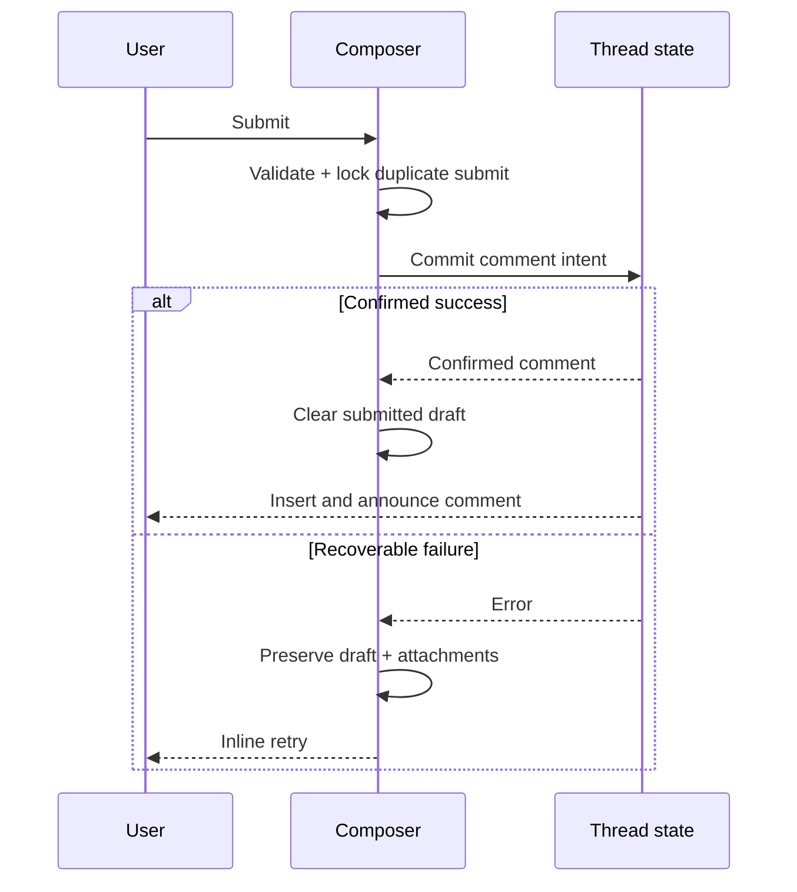
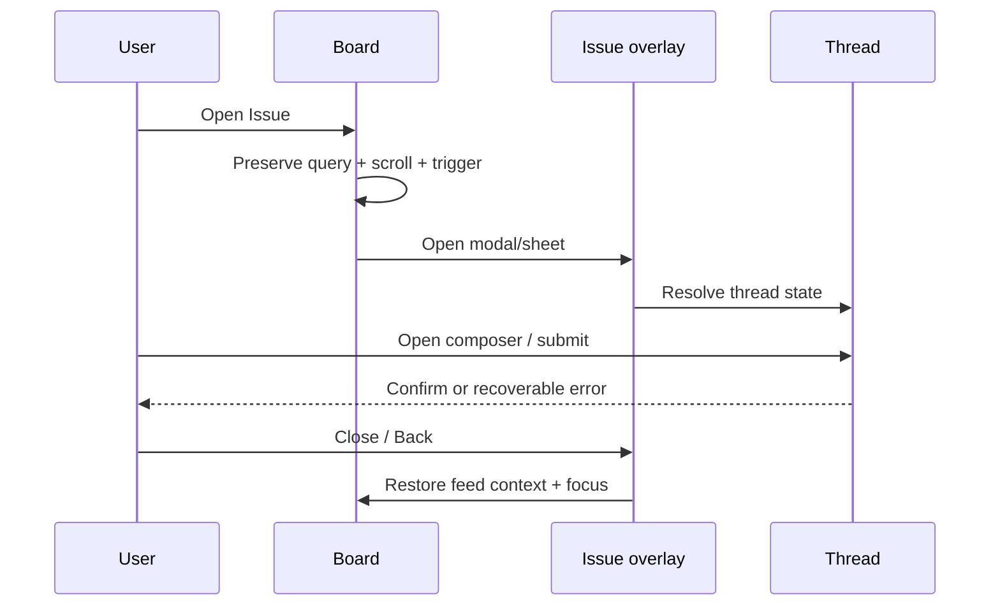
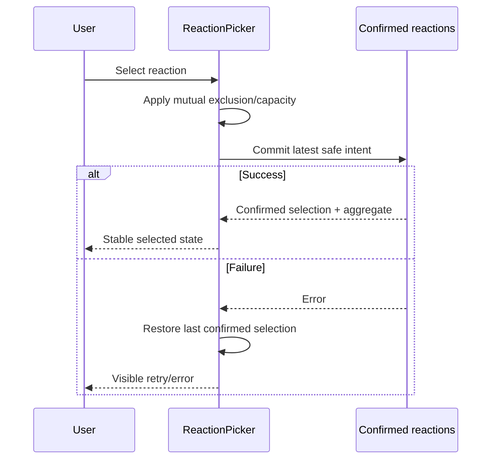

# DOGEstonia Interaction & Behavior Specification v1.0

**Scope:** `/board`, `/issue/:id`, Issue overlays, thread, reactions, map and verification handoff  
**Target:** React.js behavior, prototyping, Storybook interaction tests and QA  
**Platforms:** pointer, keyboard and touch  
**Status:** implementation handoff · validated 2026-10-08 (Partial polish → UX remediation)  
**Date:** 2026-10-06 (pack) · metadata refresh 2026-10-08  
**Related:** [INDEX](INDEX.md) · [Unified State Inventory](DOGEstonia-unified-state-inventory-v1.0.md) · [Component & Variants](DOGEstonia-component-and-variants-specification-v1.0.md) · [Data-to-UI](DOGEstonia-data-to-ui-contract-v1.0.md) · [Asset Manifest](DOGEstonia-asset-manifest-v1.0.md) · [Coverage & backlog](DOGEstonia-current-design-state-artboard-coverage-and-generation-backlog-v1.0.md)

## 1. Purpose

This specification defines how the approved DOGEstonia interface behaves over time.

For each interaction it establishes:

- trigger;
- precondition;
- immediate feedback;
- state transition;
- success result;
- recoverable failure behavior;
- focus and scroll result;
- desktop/mobile presentation differences.

It does not define backend endpoints, request bodies or persistence technology.

## 2. Behavioral principles

1. **Civic content is resilient.** Social failure never removes the Issue.
2. **Every action responds.** No interactive affordance is a silent no-op.
3. **User work survives.** Drafts, filters and feed position survive recoverable interruptions.
4. **Read and write are separate.** Unverified users can read; write attempts enter the existing verification flow.
5. **Confirmed state is distinguishable.** Optimistic UI never permanently presents a failed mutation as confirmed.
6. **Mobile is presentation adaptation.** State meaning and result are consistent across input modes.
7. **Feedback is scoped.** A local error stays near the affected action.
8. **History behaves naturally.** Browser Back reverses overlays/navigation before abandoning the board context.
9. **Accessibility is behavioral.** Focus, announcements and keyboard paths are part of the interaction contract.
10. **No attention mechanics.** Motion and feedback explain state rather than manufacture engagement.

## 3. Interaction vocabulary

| Term | Meaning |
|---|---|
| Activate | Click, tap, Enter or Space on a control |
| Commit | Action that attempts to write confirmed product state |
| Cancel | Leave a transient interaction without committing it |
| Dismiss | Close feedback/overlay while preserving underlying state |
| Retry | Repeat the failed scoped operation |
| Return context | Route, Issue, thread location, filters, scroll and draft needed after handoff |
| Confirmed state | Last state accepted by the authoritative product layer |
| Pending state | Local state awaiting confirmation |
| Recoverable error | Failure after which user content/action can be retried safely |
| Unknown outcome | Write whose completion cannot be safely inferred |

## 4. Input equivalence

Every primary action must support an explicit activation path.

| Pointer | Touch | Keyboard |
|---|---|---|
| Click | Tap | Enter/Space on focused control |
| Hover preview | No equivalent required | Focus provides equivalent information |
| Right click not required | Long press optional only | Explicit button path required |
| Wheel/trackpad scroll | Touch scroll | Arrow/Page/Home/End where native |

Hover and long press may accelerate an action but may never be the only way to discover or complete it.

## 5. Global focus rules

- focus follows DOM/reading order;
- visible focus uses design tokens and `:focus-visible` behavior;
- opening a modal/sheet moves focus to its semantic title or first meaningful control;
- modal/dialog focus is trapped inside the topmost modal surface;
- closing returns focus to the exact trigger when it still exists;
- if the trigger no longer exists, focus moves to the nearest stable heading or feed container;
- disabled controls are not focusable unless discoverability requires an `aria-disabled` control with explanation;
- focus is never moved merely because background data refreshed;
- toast feedback does not steal focus.

## 6. Global scroll rules

- the page owns the primary board scroll;
- desktop side rails do not create independent scroll columns;
- full-screen Issue sheet/modal body owns exactly one internal scroll container;
- opening an overlay freezes the underlying page without losing its position;
- closing restores the underlying position exactly;
- focused composer/reply scrolls into view while retaining enough parent context to understand what is being answered;
- automatic scroll never occurs for background reaction/count updates;
- new comment success may scroll the new comment into view only when the user submitted from that location.

## 7. Browser history and routes

### 7.1 Feed-opened Issue

Activating `Open issue`, title or approved card open target from `/board` opens an Issue overlay rather than replacing the visible board composition.

Behavioral result:

- current filters, view mode and scroll position remain preserved;
- browser Back closes the overlay first;
- closing through UI and browser Back produce the same visible result;
- reopening the Issue restores its default or last safe thread position for the current session;
- a copied/public Issue link resolves to existing `/issue/:id`.

### 7.2 Direct Issue route

Direct navigation to `/issue/:id` renders the full Issue page with the same `IssueThreadBlock`. Browser Back follows normal history.

### 7.3 Route rules

- no new Issue or verify routes are invented;
- overlay routing may use the application’s existing route-state mechanism;
- copying a link never produces a private transient overlay-only URL;
- changing filters does not silently push excessive history entries; committed query changes may replace current board state according to application routing policy.

## 8. Initial board load

### Trigger

Enter `/board`, restore session or change active node.

### Sequence

1. Render public shell immediately when available.
2. Restore identity/session independently.
3. Render stable toolbar and feed loading geometry.
4. Resolve Issue query.
5. Replace only feed result region with populated, empty-filtered or error state.
6. Resolve thread summaries progressively without blocking Issue cards.

### Rules

- session loading does not blank public content;
- thread loading does not block civic Issue rendering;
- no fake counts/comments appear in skeletons;
- obsolete requests are ignored when node/query changes before completion.

## 9. Search behavior

### Input

- user types into board search;
- user clears the input;
- restored URL/state provides a query.

### Timing

- visible input updates immediately;
- remote/filter work begins after approximately **300 ms** of typing inactivity;
- Enter commits immediately;
- clearing commits immediately;
- pending obsolete query work is cancelled or ignored;
- the latest committed query owns visible results.

### Feedback

- retain existing result content during short pending periods;
- show bounded progress in result context after the pending threshold;
- do not flash full-card skeletons on every keystroke;
- no-results retains the query and offers clear/reset.

### Keyboard

- Escape clears suggestions first, then optionally clears the query when policy is explicit;
- Enter submits current text;
- search is labelled independently from global/browser search.

## 10. Filter behavior

### Selection

- activating a chip updates its selected state immediately;
- query refresh begins immediately;
- active chips remain visible while results load;
- failure preserves the user’s intended selection and shows retry rather than silently reverting.

### Clear filters

- clears only board filter selection, not unrelated node/session state;
- resets list/map eligibility from the resulting current result set;
- keeps search text unless the control explicitly says `Clear search and filters`.

### Mobile overflow

- chips scroll horizontally;
- selecting a partially hidden chip scrolls it fully into view;
- swipe scrolling does not activate a chip accidentally.

## 11. List/map interaction

### Eligibility

Map is eligible when at least one Issue in the current result set has numeric latitude and longitude.

### Select Map

1. User activates `Map`.
2. If eligible, control selects Map and map loading begins.
3. Existing filters remain visible.
4. Pins render only for eligible Issues.
5. If M&lt;N, helper copy explains that map is a subset.

### Ineligible

- Map is disabled or hidden with honest helper copy;
- activation must not open an empty enabled map;
- list remains the full current result set.

### Pin interaction

- selecting a pin opens public Issue preview;
- selecting another pin updates preview without page navigation;
- `Open issue` opens the same Issue overlay/detail behavior as list;
- Escape closes preview before leaving map;
- mobile uses a bottom preview card that does not cover the view toggle.

### Map failure

- filters and query remain unchanged;
- present Map unavailable + return to List;
- list content remains accessible.

## 12. Board post open behavior

### Open targets

- Issue title;
- explicit `Open issue`;
- approved media/card area when semantically configured as link.

### Non-open targets

React, Comment, Share, reaction aggregate and overflow controls must not bubble into Issue open.

### Result

- desktop: centered Issue modal;
- mobile: full-screen Issue sheet;
- direct route: Issue page;
- focus moves into overlay;
- feed scroll and query context are preserved.

## 13. Post action strip

### React

- opens `ReactionPicker` anchored on desktop or sheet on mobile;
- does not immediately apply a default Like;
- read-only users may inspect reaction distribution; committing a reaction requires write permission.

### Comment

- feed collapsed thread opens/focuses discussion;
- if detail is needed, opens Issue overlay at discussion context;
- verified user can focus composer;
- unverified composer activation invokes `VerifyWriteGate`.

### Share

1. Use native share capability when supported and appropriate.
2. Otherwise copy the canonical public Issue link.
3. Show confirmation toast.
4. On failure show non-blocking retry/copy feedback.

Share never exposes private transient state or draft content.

### Reaction aggregate

- quick activation opens `ReactorsPopover` with all reactors;
- full distribution action opens `ReactionsDialog`;
- these are read interactions and do not require verification.

## 14. Issue overlay open/close

### Opening

1. Store originating trigger, route context and feed scroll.
2. Render scrim/overlay shell.
3. Lock background scroll.
4. Focus overlay title or close control according to accessible implementation.
5. Load missing detail/thread data progressively.

### Closing

Allowed triggers:

- close/back control;
- browser Back when opened from board;
- Escape on desktop/hardware keyboard;
- backdrop only when there is no destructive draft consequence.

If a dirty draft exists:

- preserve it when simply returning to the same board session where possible;
- do not discard through backdrop click;
- if discard is unavoidable, require explicit confirmation.

### Result

- background scroll unlocks;
- exact feed position restores;
- focus returns to origin;
- filter/query state remains unchanged.

## 15. Thread loading and retry

### Loading

- `IssueThreadBlock` renders stable chrome;
- civic Issue remains readable and interactive;
- loader does not invent comments or counts.

### Empty

- show `No comments yet` or equivalent;
- verified write capability exposes composer;
- empty is not presented as unavailable.

### Unavailable

- show `Discussion unavailable`;
- retry is scoped to thread;
- Issue actions unrelated to social data remain available;
- cached confirmed comments may remain visible with stale marker when product data permits.

## 16. Expand/collapse discussion

### Expand

- fetch missing branch/root details only as needed;
- preserve already rendered comments;
- announce expanded state;
- focus remains on trigger unless expansion places a requested reply/composer target.

### Collapse

- preserve scroll stability;
- retain confirmed loaded data for session reuse;
- do not discard composer draft silently;
- when draft exists, keep composer visible or require explicit cancellation.

## 17. Comment branch behavior

### Expand replies

1. Activate reply-count/expand control.
2. Show progress within that branch.
3. Append/insert replies in correct tree position.
4. Update expanded state and accessible label.

### Branch failure

- preserve parent and existing replies;
- show local retry;
- do not replace the entire thread.

### Max visual depth

- visual indentation stops at depth 3;
- deeper logical reply shows parent context at depth 3;
- do not display an affordance implying a fourth visual indentation level.

## 18. Comment sorting

- sort control applies to the thread root ordering according to product-supported options;
- changing sort does not modify reply parentage;
- visible sort label always reflects current order;
- preserve composer draft;
- preserve focused comment when feasible;
- if content reorders, announce the change without moving keyboard focus unexpectedly;
- do not invent ranking metrics or labels.

## 19. Open composer

### New comment

- activating composer affordance focuses text field for verified users;
- unverified users receive verification gate before edit/commit according to configured write-gate timing;
- default contract: unverified activation opens the gate before exposing an active write field.

### Reply

- activating `Reply` opens composer with parent context;
- reply context includes author and an accessible way to inspect the parent;
- cancel reply returns composer to new-comment mode while preserving text only when user explicitly chooses to retain it;
- at max visual depth reply remains logically attached but visually capped.

### Focus

- desktop scrolls composer into view without hiding reply context;
- mobile brings composer above keyboard and hides global bottom navigation;
- closing keyboard does not submit or discard.

## 20. Draft lifecycle

Draft states: pristine → dirty → submitting → confirmed or recoverable error.

Rules:

- text updates locally on every edit;
- draft survives attachment error, post error, verification handoff and transient thread refresh;
- switching reply target with non-empty draft requires explicit decision when content could be misattributed;
- confirmed success clears only the submitted draft;
- route/navigation retention may be session-scoped; no permanent cross-device draft storage is implied;
- sensitive draft text must not appear in analytics or logs.

## 21. Submit comment/reply

### Preconditions

- authenticated and opaque verified identity;
- non-empty valid content or approved attachment according to product rules;
- no active duplicate submission;
- thread/write capability available.

### Sequence



### Optimistic policy

An optimistic pending comment may appear only if visibly marked pending and safely reconciled. It must:

- never look permanently confirmed before success;
- become confirmed without duplicate insertion;
- revert or become failed with retry while retaining draft/content;
- use a client-local identity only internally, not as a public comment id.

### Unknown outcome

If completion cannot be known safely, do not auto-repeat. Explain uncertainty and reconcile before retry to avoid duplicate posts.

## 22. Post failure and retry

- error remains inline near composer/pending comment;
- focus moves to error only when necessary; otherwise error is announced;
- retry uses the preserved draft;
- editing after failure returns to dirty state;
- dismissing the error does not discard text;
- global toast may supplement but not replace inline feedback.

## 23. Attachment interaction

### Allowed flow

1. User activates Attach.
2. If verified and floor permits, open system picker.
3. User selects item.
4. Render local/ref preview chip.
5. Process/validate item.
6. On success mark ready.
7. Submit references with comment intent.

### Floor denied

- Attach is hidden or disabled according to discoverability needs;
- honest message explains attachments are unavailable;
- no bypass control exists.

### Item denied/error

- scope feedback to the item;
- preserve comment text and other ready items;
- allow remove and retry where safe;
- no upload endpoint names appear in UI.

### Cancel picker

Returns to composer unchanged.

## 24. Reaction picker open/close

### Desktop

- explicit React button opens picker;
- hover may preview/open after deliberate delay but is not required;
- pointer moving from trigger to picker does not collapse it immediately;
- Escape/outside click closes without committing unconfirmed local changes according to picker commit model.

### Mobile

- tap opens bottom sheet;
- long press is optional shortcut;
- sheet has explicit Done/close when selection is batch-committed;
- system Back closes picker before Issue sheet.

### Focus

- first selected option or group heading receives logical initial focus;
- arrow navigation may move among options within a group;
- Tab reaches all interactive controls;
- close returns focus to React trigger.

## 25. Reaction selection

### Rules

- enabled ids come from `reactions.v1` catalog configuration;
- localized text is primary;
- up to configured maximum, default 3;
- selecting `agree` clears `disagree` if selected;
- selecting `disagree` clears `agree` if selected;
- moderation marks are unavailable on thread root;
- disabled/omitted entries cannot be selected.

### Permission

- opening the picker may remain a read interaction;
- first selection/commit by an unverified user opens `VerifyWriteGate`;
- pending selection intent may be restored after verification, but must not be auto-committed.

### Confirmation

- optimistic visual selection is allowed because it is reversible;
- confirmed aggregate updates after success;
- failure restores last confirmed selection and shows scoped feedback;
- rapid changes collapse into the latest intended selection when safely supported;
- duplicate requests must not create duplicate reactions.

## 26. Reaction aggregate and people lists

### Open all reactors

- activate aggregate icons/count;
- desktop opens `ReactorsPopover` anchored to aggregate;
- mobile opens compact bottom sheet;
- combined list includes every reaction type;
- badge overlays avatar;
- no `Connect` action in compact list.

### Open distribution

- explicit full-distribution action opens `ReactionsDialog`;
- default tab is All;
- selecting a type filters the people list locally/remotely through existing data capability;
- active tab remains visible under horizontal overflow;
- own row shows `You`;
- other eligible rows may show `Connect`.

### Loading/error

- people rows use stable skeletons;
- error stays inside dialog/popover;
- closing remains available;
- failure never changes confirmed reaction aggregate.

## 27. Connect placeholder behavior

`Connect` is a forward-compatible person action, not yet a complete relationship workflow.

- activating provides explicit `coming soon`/not connected feedback until the concept is implemented;
- it does not silently create a relationship;
- no friend-request counters, states or endpoints are invented;
- the action appears only in the full people dialog, never the compact all-reactors popover;
- current user row uses `You` and is not actionable.

## 28. Verify-before-write

### Protected actions

- start/submit comment;
- reply;
- commit reaction;
- open attachment picker;
- other approved thread writes.

### Sequence

```mermaid
sequenceDiagram
    participant U as User
    participant O as Origin interaction
    participant G as Verify gate
    participant V as Existing /verify
    U->>O: Attempt protected write
    O->>G: Preserve return context
    G-->>U: Verify to continue
    U->>V: Continue
    alt Verified
        V-->>O: Return with opaque verified result
        O-->>U: Restore Issue/thread and intent
    else Cancelled or failed
        V-->>O: Return unverified
        O-->>U: Restore context; write remains blocked
    end
```

### Return context

Must include enough application state to restore:

- board/Issue origin;
- Issue identity;
- thread/comment target;
- filters and view mode when relevant;
- feed scroll anchor;
- recoverable draft/attachment intent;
- intended action without auto-committing it.

### Result

- success copy says `Verified`;
- verification method is not shown;
- composer receives focus after return when that was the intent;
- draft remains for user review;
- no automatic comment/reaction submission after verification.

## 29. Escalation stub

### Idle

Compact secondary invitation is visible in approved thread chrome.

### Activate

- show toast or lightweight modal: collaboration handoff is not connected yet;
- feedback is immediate;
- action does not create a ticket, SLA or organization workflow;
- focus remains on trigger for toast, or follows normal modal rules for dialog.

### Disabled/soon

If rendered disabled, honest supporting copy is visible or discoverable; do not leave a dead control.

## 30. Share interaction

### Native share available

- invoke platform share with canonical Issue title/link;
- cancellation produces no error;
- failure produces retry/copy alternative.

### Native share unavailable

- copy canonical public Issue link;
- show success toast;
- if clipboard is denied, show selectable link or explicit failure recovery.

Never share raw schema payloads, private draft, non-public geo or transient modal state.

## 31. Overflow menus

- activation opens a menu anchored to trigger or mobile action sheet;
- only currently permitted actions appear;
- destructive actions, if later approved, require distinct confirmation;
- Escape/outside click closes non-destructive menus;
- selecting an item closes menu unless the item opens a nested confirmation;
- menus never duplicate primary React/Comment/Share actions without purpose.

## 32. Toast behavior

| Feedback | Duration | Persistent alternative |
|---|---:|---|
| Copied/shared | short, ~3–4 s | none required |
| Escalation not connected | medium, ~5 s | repeatable from trigger |
| Background refresh recovered | short | none required |
| Actionable write error | toast optional | inline required |
| Offline | persistent while relevant | inline/banner required |

Rules:

- pause timeout while hovered/focused when the toast is interactive;
- one region manages stacking;
- deduplicate identical rapid feedback;
- toast does not cover bottom navigation/composer/safe area;
- no success confetti or gamified effects.

## 33. Inline message behavior

- associated with affected control/region;
- appears without shifting critical controls out of reach when possible;
- error text is announced and programmatically associated;
- retry keeps the user in context;
- message clears after successful recovery or relevant input change;
- dismissal never implies the failed operation succeeded.

## 34. Keyboard contract

| Key | Context | Result |
|---|---|---|
| Tab / Shift+Tab | Global | Move through interactive elements in logical order |
| Enter / Space | Focused button/chip | Activate |
| Escape | Popover/menu | Close topmost transient surface |
| Escape | Modal/dialog | Close if dismissible and draft-safe |
| Arrow keys | Segmented control/tabs | Move selection/focus according to native pattern |
| Home/End | Tabs/list where supported | First/last item |
| Enter | Single-line search | Commit query |
| Enter | Multiline composer | New line |
| Cmd/Ctrl+Enter | Composer | Submit when valid |

Do not hijack browser shortcuts or create undocumented keyboard-only actions.

## 35. Touch and gesture contract

- primary actions use tap;
- horizontal chip swipes do not accidentally select;
- mobile sheets may support drag-to-dismiss only when it cannot discard a dirty draft;
- explicit close/back remains available even when swipe dismissal exists;
- long press is optional for reaction picker, never required;
- pinch/drag behavior belongs to generic map interaction only;
- touch targets follow preferred 44 px minimum and 48 px for primary mobile controls.

## 36. Pointer contract

- hover is visual preview/emphasis, not committed state;
- cursor communicates interactive areas;
- cards do not become one giant ambiguous click target when they contain nested actions;
- hover-open reaction picker uses a deliberate delay and forgiving pointer corridor;
- menus/popovers do not flicker when pointer crosses from trigger to surface;
- tooltips do not contain essential actions.

## 37. Motion behavior

| Interaction | Duration token | Behavior |
|---|---|---|
| Hover/focus color | fast, 100 ms | Color/border only |
| Button/chip response | short, 160 ms | Subtle state response |
| Popover/dialog | medium, 240 ms | Fade + small spatial cue |
| Mobile sheet | long, 320 ms | Translate from bottom + scrim |
| Error appearance | short/medium | No shake |

Reduced motion:

- remove transforms;
- use near-instant opacity/state change;
- preserve focus movement and state announcements;
- avoid looping shimmer where a static skeleton is sufficient.

## 38. Concurrent request behavior

### Search/filter

- latest committed query wins;
- obsolete responses cannot overwrite current results;
- changing node invalidates previous node result ownership.

### Comment submit

- one active submission per draft;
- disable/dedupe repeated activation;
- unknown outcome is reconciled before retry.

### Reactions

- local selection may change rapidly;
- confirmed state reconciles to latest safe intent;
- failure restores last confirmed state;
- aggregate count does not double increment from retries.

### Thread refresh

- preserve loaded civic Issue and user draft;
- new confirmed comments merge without duplicating existing identities;
- do not move focus during background refresh.

### Overlay fetch

- closing an overlay makes late responses non-visible/non-owning;
- reopening uses valid cached data while refreshing when allowed.

## 39. Stale and offline behavior

### Stale readable data

- retain content;
- mark stale/retry state honestly;
- writes remain governed by actual connectivity/permission;
- do not imply freshness through updated timestamps that were not refreshed.

### Known offline

- public cached content may remain readable;
- write controls explain unavailable state;
- no offline mutation queue is assumed;
- drafts remain local for manual retry;
- recovered connectivity does not auto-submit uncertain writes.

## 40. Loading timing

- under ~150 ms: avoid flashing loader;
- 150 ms–1 s: local subtle progress/skeleton;
- longer: stable skeleton plus accessible loading status;
- no artificial minimum delay after content is ready;
- progressive thread/reaction loading must not block Issue content.

These are interaction guidelines, not network timeout definitions.

## 41. Empty/error distinction

| Result | Meaning | User action |
|---|---|---|
| Empty | Successful response, no content | Start/clear/change query as relevant |
| Ineligible | Capability cannot apply to current data | Use available view/action |
| Denied | Policy/permission blocks action | Verify or accept explanation |
| Unavailable | Dependent capability failed | Retry while unaffected content remains |
| Error | Scoped operation failed | Correct/retry |
| Unknown | Write outcome cannot be proven | Reconcile before repeating |

## 42. Responsive behavior parity

| Interaction | Desktop | Mobile |
|---|---|---|
| Open Issue | Center modal | Full-screen sheet |
| Close Issue | X, Escape, Back | Back/close, system Back |
| Reaction picker | Anchored popover | Bottom sheet |
| All reactors | Compact popover | Compact sheet |
| Distribution | Center dialog | Bottom sheet |
| Composer | Inline/sticky modal | Sticky above keyboard |
| Navigation | Header + rails | App bar + bottom nav |
| Pin preview | Popup/callout | Bottom preview card |

The success/failure result is identical across presentations.

## 43. Accessibility announcements

Announce without moving focus where appropriate:

- results updated and result count when authoritative;
- map subset explanation;
- discussion loaded/unavailable;
- comment posted/failed;
- attachment ready/denied/failed;
- reaction selected/removed and exclusion result;
- verification success;
- copied link;
- recovered/offline status.

Avoid announcing every background count change when it would create noise.

## 44. Deep-link and refresh recovery

### Refresh `/board`

- restore URL-backed query/filter/view state;
- session-only scroll restoration is optional but preferred for same-tab return;
- drafts require an explicit retention policy and must not leak across users.

### Refresh `/issue/:id`

- reload Issue detail page, not an orphaned modal;
- mount same `IssueThreadBlock`;
- missing Issue uses not-found state with board return.

### Shared link

- opens public Issue route;
- does not require access to sender’s feed/modal state;
- excludes private thread/draft/filter information.

## 45. Localization behavior

- controls allow text expansion without overlap;
- mobile bottom navigation uses approved short labels per locale;
- tabs/chips scroll rather than shrink below readable size;
- Issue titles/comments wrap naturally;
- person names truncate in constrained rows with full accessible name;
- relative dates use locale-aware output;
- no image-embedded functional copy;
- right-to-left behavior is not required by current ET/RU/EN scope but component order should not make future support impossible.

## 46. Privacy and safety behavior

- public UI never reveals raw payload/bind/hash fields;
- geo callouts expose only approved public fields;
- verification method stays opaque;
- attachment floor cannot be disabled;
- moderated/deleted comment tombstones do not leak protected reasons;
- share copies only canonical public data;
- drafts do not enter analytics/logs;
- Connect placeholder does not imply a relationship was created.

## 47. Required interaction test scenarios

### Board

1. Type search rapidly; only latest result wins.
2. Apply filters, switch List→Map→List; state remains consistent.
3. Attempt Map with zero eligible Issues; no empty enabled map opens.
4. Select pin in partial map; open Issue and return to same map state.

### Issue overlay

1. Open from mid-feed; close and verify exact scroll restoration.
2. Open and press browser Back; overlay closes before leaving board.
3. Direct-load `/issue/:id`; verify page mount rather than modal orphan.
4. Thread fails; Issue remains readable.

### Comments

1. Open reply at depth 3; no fourth indentation appears.
2. Submit successfully; one confirmed comment appears.
3. Submit failure; draft remains and retry works.
4. Expand one branch failure; rest of thread remains stable.
5. Open keyboard on mobile; composer remains visible above it.

### Attachments

1. Cancel system picker; composer unchanged.
2. Item denied; text and other attachments remain.
3. Floor denied; no bypass control exists.

### Reactions

1. Select agree then disagree; agree clears.
2. Reach capacity 3; clear hint appears.
3. Save failure; confirmed state restores.
4. Open aggregate; compact combined list has no Connect.
5. Open distribution; other rows may show Connect, self shows You.

### Verification

1. Unverified user activates protected write.
2. Continue to `/verify`, succeed and return to same Issue/context.
3. Confirm result says Verified without method.
4. Confirm draft/intent restored but not auto-submitted.
5. Cancel verification and verify write remains blocked without losing context.

### Accessibility

1. Complete all primary flows using keyboard only.
2. Close nested surfaces with Escape in correct order.
3. Verify focus returns to trigger.
4. Verify reduced-motion flows preserve comprehension.
5. Verify 320 px reflow without page-level horizontal scroll.

## 48. Interaction sequence: open, comment, return



## 49. Interaction sequence: reaction mutation



## 50. Definition of interaction-ready

An interaction is ready for development when:

- trigger and preconditions are explicit;
- loading/pending feedback is defined;
- success and recoverable failure results are defined;
- unknown outcomes cannot duplicate writes;
- focus and scroll results are defined;
- keyboard and touch paths exist;
- responsive presentation is mapped;
- state IDs and owning components are known;
- analytics/private-data boundaries are respected;
- acceptance test scenario exists for critical behavior.

## 51. Package acceptance checklist

- [ ] Browser Back closes a feed-opened Issue before leaving the board.
- [ ] Direct `/issue/:id` uses the full page mount.
- [ ] Feed filters, view mode and scroll survive overlay round trips.
- [ ] Search/filter race conditions use latest-result ownership.
- [ ] Map eligibility is based only on numeric lat+lon.
- [ ] Nested actions do not accidentally open the Issue card.
- [ ] Drafts survive verification, attachment and recoverable post errors.
- [ ] Duplicate comment/reaction commits are prevented.
- [ ] Unknown write outcomes reconcile before retry.
- [ ] Agree/disagree exclusion and capacity are enforced visibly.
- [ ] Moderation is unavailable on thread root.
- [ ] Compact reactors list has no Connect; full dialog may have it.
- [ ] Verify result remains method-opaque and does not auto-submit.
- [ ] Escalation and Connect placeholders provide explicit feedback.
- [ ] Every modal/sheet defines open focus, trap, dismissal and focus return.
- [ ] Mobile composer remains above the software keyboard.
- [ ] Toasts never replace required inline corrective feedback.
- [ ] Reduced-motion behavior preserves all state meaning.
- [ ] Privacy-sensitive data never enters share UI or feedback copy.

