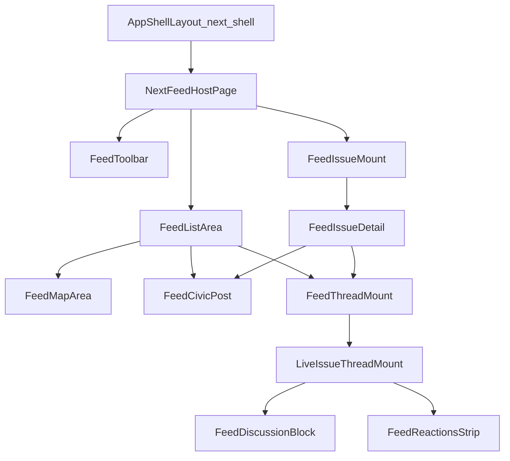

# DOGEstonia — next/feed layouts · pages · components catalog v1.0

> **Zone:** `#/next/feed*` (spa-app next-feed product home)  
> **As-of:** 2026-10-12 · verified against `spa-app/src/` + artboards M149–M160  
> **Mode:** analysis.mdc — claims below are grounded in code paths and written artboard specs; no invent API/icons  
> **Parent UX INDEX:** [INDEX.md](INDEX.md) · **Package:** [next-feed INDEX](../../tasks/backlog-stories/next-feed/INDEX.md)  
> **Authority when sources disagree:** REQ-22 → [DUI-Q01–Q18](DOGEstonia-DUI-Q01-Q18-phase-1-decision-record-2026-10-08.md) → written artboard `.md` → this catalog (runtime map) → PNG tone only

---

## §0 Validation snapshot (NF-07…12)

| Check | Result |
|-------|--------|
| Materialize docs (stories · ARCH-DELTA · epic pipelines/tasks · AD-VP arch/DUI · proposal Materialized) | **PASS** |
| Product stories NF-07…10, NF-12 | **Done** (P3 pkgs `000109`…`000112`, `000114`) |
| NF-11 live↔artboard gate | **Done · PASS** (`2026-10-11T15:47:08Z`) · [parity-report](../../analysis/evidence/next-feed-live-artboard-parity-2026-10-11-nf11/parity-report-STORY-SPA-NF-11-2026-10-11.md) |
| FE `search` (REQ-56) | **Done** — `GatewayIssueRepository.buildIssuesQuery` appends `search`; `serializeServerBoardQuery` keeps it |
| Index/epic/api-req sync (pre-2026-10-12) | Was **FAIL** (NF-11 Todo drift) → **fixed** with this wave |

Tip order delivered: `07→08→09→10→12→11`. Shell chrome / M155 / invent HTTP remain OOS.

---

## 1. Meta · scope

| Item | Value |
|------|--------|
| Product routes | `#/next/feed`, `#/next/feed/issue/:id` (+ `?presentation=modal\|sheet\|route`) |
| Code home | `spa-app/src/features/feed/` · host `spa-app/src/pages/NextFeedHostPage.jsx` |
| Data plane | Gateway `GET /node/issues` (+ Closed threads + identity `/me`) — one plane (arch 00 Q4) |
| Presentation rule | Reskin mandatory on `#/next/feed*` ([AD-VP-01](../../tasks/backlog-stories/next-feed/ARCH-DELTA-visual-parity-wave-2026-10-11.md)); classic M143/M148 chrome ≠ Done |
| Shell | Header / ProfileRail / AppShell — **next-shell**; not re-owned here |
| Classic shelter | `#/board` / `BoardPage` — temporary (REQ-22); not this catalog’s primary map |

Artboard files live under [`artboards/`](artboards/) — each ID has colocated `.md` + `.png`.

---

## 2. Pages / routes

Verified in [`App.jsx`](../../../src/App.jsx): `/` → redirect `/next/feed`; routes `/next/feed` and `/next/feed/issue/:id` both render `NextFeedHostPage`.

| Route / URL shape | Page module | What the user sees | Primary artboards |
|-------------------|-------------|--------------------|-------------------|
| `#/next/feed` | [`NextFeedHostPage.jsx`](../../../src/pages/NextFeedHostPage.jsx) | Feed list (or map) + toolbar; cards with civic + Discussion | [M149](artboards/mockup-m149-board-shell-feed-query-states-state-sheet-spec-v1.0.md) · [M150](artboards/mockup-m150-issue-post-content-schema-overlay-state-sheet-spec-v1.0.md) · [M151](artboards/mockup-m151-board-list-map-toggle-ssr-m-state-sheet-spec-v1.0.md) · [M152](artboards/mockup-m152-current-board-issue-post-thread-block-states-state-sheet-spec-v1.0.md) |
| `#/next/feed?search=…&…` | same | Structural filters + live text search (NF-12) on list HTTP | M149 (+ search control) |
| `#/next/feed/issue/:id` | same + [`FeedIssueMount`](../../../src/features/feed/FeedIssueMount.jsx) | Issue detail in modal / sheet / route; civic + Discussion | [M158](artboards/mockup-m158-current-issue-modal-sheet-detail-parity-state-sheet-spec-v1.0.md) + M150/M152–M154/M156–M157 |
| `?presentation=route\|modal\|sheet` | `FeedIssueMount` | Forces mount chrome; product body = `FeedIssueDetail` | M158 |
| Shell frame (all above) | [`AppShellLayout`](../../../src/layout/AppShellLayout.jsx) · Header · ProfileRail | Chrome around feed content | M149 shell panels → **next-shell** register |

**Host responsibilities** (`NextFeedHostPage`): parse board query; lock public list `status=PUBLISHED` via `buildFeedListOptions`; load issues; expose toolbar + list/map; open issue mount when `:id` present; narrow detection for sheet vs modal (`useFeedNarrow`).

---

## 3. Layouts (geometry ownership)

SSOT geometry: [DOGEstonia-dashboard-layout-spec-v1.0.md](DOGEstonia-dashboard-layout-spec-v1.0.md) · mobile: [DOGEstonia-mobile-responsive-design-pack-v1.0.md](DOGEstonia-mobile-responsive-design-pack-v1.0.md).

| Zone | Owner package | Runtime | Feed catalog note |
|------|---------------|---------|-------------------|
| Header 64px / left rail / right rail / mobile bottom nav | **next-shell** | `AppShellLayout`, `Header`, `ProfileRail`, … | Cited by M149; not implemented in `features/feed/` |
| Center feed column | **next-feed** | `NextFeedHostPage` → `FeedToolbar` + `FeedListArea` | Flexible width; feed-first |
| Toolbar band | next-feed | `FeedToolbar` | Search + structural filters + List\|Map |
| Card stack / map | next-feed | `FeedListArea` → `FeedCivicPost` + thread · or `FeedMapArea` | List composure / skeleton NF-10 |
| Issue overlay / sheet / route page | next-feed | `FeedIssueMount` → `FeedIssueDetail` | Same civic+Discussion product; chrome differs (M158) |
| Narrow body ≤ ~390 | next-feed + shell | `useFeedNarrow` (`FEED_NARROW_MQ`) | M159 body stress; shell chrome OOS |

**Presentation boundary (AD-VP-02):** visual wrappers live in `features/feed/`; Closed clients/catalogs stay in `components/threads` / repositories.

---

## 4. Composition tree

---

## 5. Artboard index (M149–M160)

| ID | Spec | PNG | Surface / function |
|----|------|-----|--------------------|
| **M149** | [spec](artboards/mockup-m149-board-shell-feed-query-states-state-sheet-spec-v1.0.md) | [png](artboards/mockup-m149-board-shell-feed-query-states-state-sheet-spec-v1.0.png) | Shell + feed/toolbar; load/empty/error/stale/retry; search control |
| **M150** | [spec](artboards/mockup-m150-issue-post-content-schema-overlay-state-sheet-spec-v1.0.md) | [png](artboards/mockup-m150-issue-post-content-schema-overlay-state-sheet-spec-v1.0.png) | Civic Issue-as-post; 4-zone strip; no schema/media prod claim |
| **M151** | [spec](artboards/mockup-m151-board-list-map-toggle-ssr-m-state-sheet-spec-v1.0.md) | [png](artboards/mockup-m151-board-list-map-toggle-ssr-m-state-sheet-spec-v1.0.png) | List \| Map toggle; pin eligibility; partial map |
| **M152** | [spec](artboards/mockup-m152-current-board-issue-post-thread-block-states-state-sheet-spec-v1.0.md) | [png](artboards/mockup-m152-current-board-issue-post-thread-block-states-state-sheet-spec-v1.0.png) | Collapsed Discussion under civic; load/empty/populated/error |
| **M153** | [spec](artboards/mockup-m153-current-comment-tree-composer-attachments-state-sheet-spec-v1.0.md) | [png](artboards/mockup-m153-current-comment-tree-composer-attachments-state-sheet-spec-v1.0.png) | Expanded tree + oval composer; text path |
| **M154** | [spec](artboards/mockup-m154-current-reactions-v1-strip-picker-state-sheet-spec-v1.0.md) | [png](artboards/mockup-m154-current-reactions-v1-strip-picker-state-sheet-spec-v1.0.png) | Reactions strip + picker (desktop/mobile) |
| **M155** | [spec](artboards/mockup-m155-reaction-people-surfaces-state-sheet-spec-v1.0.md) | [png](artboards/mockup-m155-reaction-people-surfaces-state-sheet-spec-v1.0.png) | People / Connect — **OOS** (no NF story) |
| **M156** | [spec](artboards/mockup-m156-current-collaboration-invitation-stub-state-sheet-spec-v1.0.md) | [png](artboards/mockup-m156-current-collaboration-invitation-stub-state-sheet-spec-v1.0.png) | Invite-org stub (no send HTTP) |
| **M157** | [spec](artboards/mockup-m157-current-verify-before-write-state-sheet-spec-v1.0.md) | [png](artboards/mockup-m157-current-verify-before-write-state-sheet-spec-v1.0.png) | Verify-before-write → `/verify`; draft honesty |
| **M158** | [spec](artboards/mockup-m158-current-issue-modal-sheet-detail-parity-state-sheet-spec-v1.0.md) | [png](artboards/mockup-m158-current-issue-modal-sheet-detail-parity-state-sheet-spec-v1.0.png) | Modal / sheet / direct route parity |
| **M159** | [spec](artboards/mockup-m159-current-mobile-responsive-critical-states-state-sheet-spec-v1.0.md) | [png](artboards/mockup-m159-current-mobile-responsive-critical-states-state-sheet-spec-v1.0.png) | Narrow/tablet critical crops (feed body) |
| **M160** | [spec](artboards/mockup-m160-current-theme-localization-interaction-stress-state-sheet-spec-v1.0.md) | [png](artboards/mockup-m160-current-theme-localization-interaction-stress-state-sheet-spec-v1.0.png) | Light/dark · L10n · focus/stress |

Register map: [NF-feed-mockup-intake-register.md](../../tasks/backlog-stories/next-feed/NF-feed-mockup-intake-register.md).

---

## 6. Component inventory (runtime)

Paths relative to `spa-app/src/` unless noted.

### 6.1 Host & list plane

| Runtime | Path | Function | Artboards | Stories |
|---------|------|----------|-----------|---------|
| `NextFeedHostPage` | `pages/NextFeedHostPage.jsx` | L2 host: query, list load, view mode, issue mount | M149, M151, M158 | NF-01…06, NF-10, NF-12 |
| `buildFeedListOptions` | `features/feed/buildFeedListOptions.js` | Builds `getIssues` options; locks `PUBLISHED`; passes `search` | M149 / REQ-56 | NF-01, NF-12 |
| `FeedToolbar` | `features/feed/FeedToolbar.jsx` | Live text search + structural filters + List\|Map control | M149, M151 | NF-01, NF-03, NF-12 |
| `FeedListArea` | `features/feed/FeedListArea.jsx` | Result region: loading/empty/filtered-empty/error/stale + list or map | M149, M151, M160 | NF-01, NF-03, NF-10 |
| `FeedFeedSkeleton` | `features/feed/FeedFeedSkeleton.jsx` | List loading composure (FE-only) | M149/M160 | NF-10 |
| `FeedListMapToggle` | `features/feed/FeedListMapToggle.jsx` | List \| Map switch chrome | M151 | NF-03 |
| `FeedMapArea` | `features/feed/FeedMapArea.jsx` | Map surface; uses `BoardIssuesMap` + geo eligibility | M151 | NF-03 |
| `useFeedNarrow` | `features/feed/useFeedNarrow.js` | Narrow MQ for sheet vs modal | M159 | NF-06 |

### 6.2 Civic post

| Runtime | Path | Function | Artboards | Stories |
|---------|------|----------|-----------|---------|
| `FeedCivicPost` | `features/feed/FeedCivicPost.jsx` | Issue-as-post; honest meta/geo/status; **4-zone** React\|Comment\|Share\|Reactions; no schema overlay / media prod; civic paw = honest omit (catalog gap) | M150 | NF-02, NF-07 |
| `FeedReactionOpenProvider` / `useFeedReactionOpen` | `features/feed/FeedReactionOpenContext.jsx` | UI bridge: civic Reactions/React → root picker open (no second HTTP) | M150, M154 | NF-07, NF-09 |

### 6.3 Discussion / thread

| Runtime | Path | Function | Artboards | Stories |
|---------|------|----------|-----------|---------|
| `FeedThreadMount` | `features/feed/FeedThreadMount.jsx` | Mount Closed `LiveIssueThreadMount` with feed L10N/icons; invite stub honesty; **no M155** | M152–M157 | NF-04, NF-05, NF-08 |
| `LiveIssueThreadMount` | `components/threads/LiveIssueThreadMount.jsx` | Closed threads fetch/compose/reactions wire | — (semantics) | THR / NF-04/05 |
| `FeedDiscussionBlock` | `features/feed/FeedDiscussionBlock.jsx` | Next-feed Discussion presentation (collapsed + expand); no classic 3-button DISCUSSION row | M152, M153 | NF-08 |
| `IssueThreadBlock` | `components/threads/IssueThreadBlock.jsx` | Shared thread semantics (classic chrome not Done on next-feed) | M152–M153 (semantics) | NF-04; reskin via NF-08 |
| `BoardIssuePost` | `components/threads/BoardIssuePost.jsx` | May appear in list composition with civic; classic sibling | M150/M152 | NF-02 related |

### 6.4 Reactions · gates · stubs

| Runtime | Path | Function | Artboards | Stories |
|---------|------|----------|-----------|---------|
| `FeedReactionsStrip` | `features/feed/FeedReactionsStrip.jsx` | Compact strip + picker chrome; Closed reaction catalog/PUT | M154 | NF-05, NF-09 |
| Invite stub | via thread mount / Closed UI | Local stub only — no send/persist HTTP | M156 | NF-05 |
| Verify-before-write | identity `GET /me` → gate in thread write path | Handoff `/verify`; draft honesty on 403 | M157 | NF-05 |

### 6.5 Issue mounts

| Runtime | Path | Function | Artboards | Stories |
|---------|------|----------|-----------|---------|
| `FeedIssueMount` | `features/feed/FeedIssueMount.jsx` | Chooses modal / sheet / route chrome (`presentation`) | M158, M159 | NF-06 |
| `FeedIssueDetail` | `features/feed/FeedIssueDetail.jsx` | Shared product body: civic + Discussion for all mounts | M158 + M150/M152+ | NF-06 |

### 6.6 Icons · L10N helpers

| Runtime | Path | Function | Notes |
|---------|------|----------|-------|
| `nextFeedIconCatalog` | `features/feed/nextFeedIconCatalog.js` | Runtime URL list for `/icons/next-feed/…` | [icon assets](../../tasks/backlog-stories/next-feed/STORY-SPA-NF-icon-assets.md) |
| `feedThreadT` / `feedThreadIcons` | `features/feed/feedThreadT.js` · `feedThreadIcons.js` | Prefer `nextFeed.*` keys; fall through `threadsFeed.*` | NF-04/05/08 L10N |

### 6.7 Shell adjacency (not feed-owned)

| Runtime | Path | Artboard cite |
|---------|------|---------------|
| `AppShellLayout` | `layout/AppShellLayout.jsx` | M149 shell |
| `Header` | `components/AppShell/Header.jsx` | M149 |
| `ProfileRail` | `components/AppShell/ProfileRail.jsx` | M149 |
| `BoardIssuesMap` | `components/map/BoardIssuesMap.jsx` | M151 (map engine reuse) |

---

## 7. Functional map by user job

| User job | Where it happens | Data / contract | Artboard |
|----------|------------------|-----------------|----------|
| Browse published issues | `FeedListArea` list | `GET /node/issues?status=PUBLISHED…` | M149 |
| Text by text | `FeedToolbar` → `buildFeedListOptions.search` | gateway param **`search`** (REQ-56) | M149 |
| Filter structurally | toolbar chips / draft filters | status/type/labels/institution/dates/geo | M149 |
| Switch List \| Map | `FeedListMapToggle` / toolbar | client view; pins need `geo.lat/lon` | M151 |
| Read civic card | `FeedCivicPost` | issue payload fields; honest omit empty | M150 |
| React / Comment / Share / open Reactions | 4-zone civic strip | Closed reactions + scroll/focus Discussion; React/Reactions via context | M150, M154 |
| Expand Discussion / reply | `FeedDiscussionBlock` | Closed comments tree + composer | M152, M153 |
| Open issue focused | navigate `#/next/feed/issue/:id` | same issue + thread product | M158 |
| Verify to write | write gate | `identity_verified` from `/me` | M157 |
| Invite org | stub control | **no** HTTP | M156 |
| Theme / L10n stress | tokens + i18n | existing `data-theme` / locales | M160 |

**Honest visual note (2026-10-12):** composition/checklist Done ≠ artboard visual language. See [why-still-classic](../../analysis/analysis-next-feed-why-still-looks-classic-2026-10-12.md) · [UX DS gaps](../../analysis/analysis-next-feed-ux-ds-element-mapping-and-gaps-2026-10-12.md) · **[component DS v1.0](DOGEstonia-next-feed-component-design-system-v1.0.md)** · **[next-feed-vl](../../tasks/backlog-stories/next-feed-vl/INDEX.md)** (VL постановка).

---

## 8. Story ownership (quick)

| Wave | Keys | Focus |
|------|------|--------|
| Content | NF-01…06 | Wire list/toolbar/civic/map/thread/reactions/mounts |
| Visual parity | NF-07…10 | Reskin civic 4-zone, Discussion, reactions chrome, light composure |
| Search FE | NF-12 | DUI-Q12 lift · `search` wire |
| Gate | NF-11 | Live↔artboard evidence (verify-only) |

Details: [next-feed INDEX](../../tasks/backlog-stories/next-feed/INDEX.md) · [ARCH-DELTA](../../tasks/backlog-stories/next-feed/ARCH-DELTA-visual-parity-wave-2026-10-11.md).

---

## 9. OOS / honesty (do not claim as Done here)

| Topic | Status |
|-------|--------|
| M155 people / Connect / reactors dialogs | Artboard exists · **no** STORY-SPA-NF · not in `FeedThreadMount` |
| Schema overlay / media production | Gated / OOS (M150 honesty) |
| Real invite send | No API — stub only (M156) |
| Shell redesign | next-shell |
| Invent gateway/threads endpoints or search param names | Forbidden |
| Classic `#/board` as next-feed Done presentation | Shelter only |

---

## 10. Cross-links

| Doc | Role |
|-----|------|
| [UX INDEX](INDEX.md) | Reading order SSOT packs |
| [Component & variants pack](DOGEstonia-component-and-variants-specification-v1.0.md) | UX canonical names / variants |
| [Interaction pack](DOGEstonia-interaction-and-behavior-specification-v1.0.md) | Behavior over time |
| [DUI decision record](DOGEstonia-DUI-Q01-Q18-phase-1-decision-record-2026-10-08.md) | Phase 1 locks (+ Q12 amendment) |
| [Arch 02 composition](../../architecture/feed-visual-redesign-phase-1/02-features-feed-composition.md) | Reskin + presentation boundary |
| [PRODUCT-BRIEF](../../tasks/backlog-stories/next-feed/PRODUCT-BRIEF.md) | Package intent |
| [API requirements](../../tasks/backlog-stories/next-feed/STORY-SPA-NF-api-requirements.md) | Closed contracts |
| [Parity audit 2026-10-10](../../analysis/analysis-next-feed-live-artboard-parity-audit-2026-10-10.md) | Pre-wave live≠artboard |

---

## 11. Changelog

| Date | Change |
|------|--------|
| 2026-10-12 | v1.0 — first unified route→layout→component→artboard catalog; §0 validation after NF-07…12 Done + index sync |
