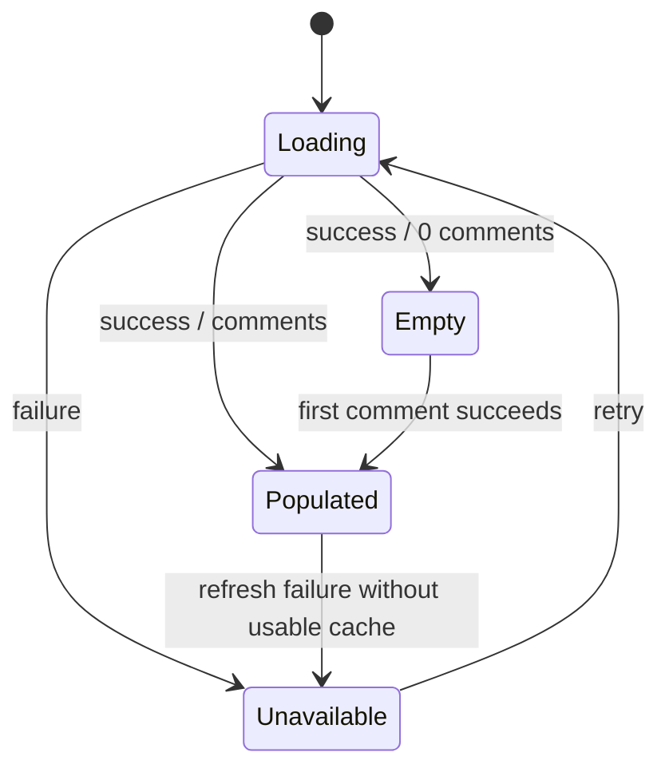
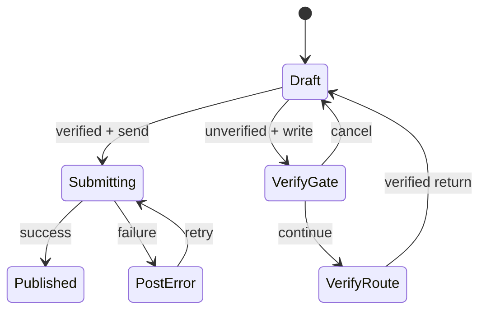
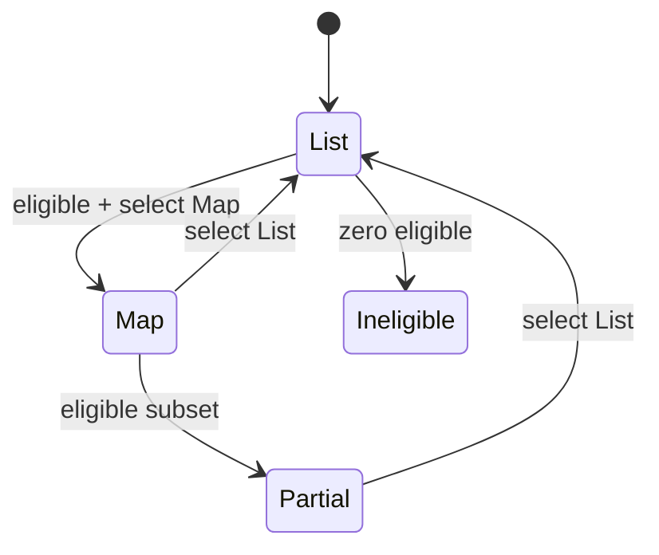

# DOGEstonia Unified State Inventory v1.0

**Scope:** public/authenticated `/board`, `/issue/:id`, Issue social layer and responsive shells  
**Target:** product design, React state modelling, Storybook, fixtures and QA  
**Status:** implementation handoff  
**Authority:** state meaning in this document overrides incidental content visible in generated mockups

## 1. Purpose

This inventory is the canonical registry of UI states currently required by the DOGEstonia dashboard design.

It answers five implementation questions for every state:

1. What condition activates it?
2. What must remain visible?
3. What may the user do?
4. How does it fail safely?
5. Does mobile use the same state or a different presentation?

The inventory is not an API contract. State names describe product/UI meaning and must not be interpreted as invented gateway fields or endpoints.

## 2. State model

### 2.1 Independent state axes

The interface state is composed from independent axes rather than one giant page enum.

| Axis | Values |
|---|---|
| Data | idle, loading, empty, populated, partial, stale, unavailable, error |
| Identity | anonymous, authenticated-unverified, authenticated-verified |
| Permission | read, write-blocked, write-enabled, action-denied |
| View | list, map, Issue sheet/modal, Issue page |
| Thread | loading, empty, collapsed-populated, expanded, unavailable |
| Interaction | rest, hover, focus, pressed, picker-open, composer-open, dialog-open |
| Connectivity | online, retrying, offline-known, recovered |
| Viewport | desktop, tablet, mobile, compact-320 |
| Theme | light, dark |

Not every combination requires a separate artboard. Components compose the applicable axes.

### 2.2 Precedence

When several conditions are true, render them in this order:

1. legal/safety denial;
2. permission or verification gate;
3. unavailable/error;
4. loading/retrying;
5. empty;
6. populated/partial;
7. transient interaction state.

Example: if attachment is legally denied while the thread is otherwise populated, the comment tree remains populated and only the attachment action uses the denied state.

### 2.3 State invariants

- Civic Issue identity is independent from social/thread availability.
- Loading, empty and error are distinct.
- Empty is a successful response with no data; it is not an error.
- Partial is honest available data with a known omitted subset.
- Stale data remains readable and is explicitly marked.
- Fail-soft state preserves unaffected functionality.
- Absence of optional data removes its chrome rather than showing an empty shell.
- Demo content appears only in explicit populated fixtures, never as fallback content.
- Mobile changes presentation, not state meaning.
- Dark mode changes tokens, not state availability.

## 3. Naming and lifecycle

### 3.1 Stable state IDs

Existing project IDs remain unchanged:

- `SSR-C-*` — Issue schema overlay;
- `SSR-M-*` — list/map;
- `THR-P-*` — feed post/thread composition;
- `THR-T-*` — comment tree/composer/attachments;
- `THR-R-*` — reactions;
- `THR-E-*` — escalation;
- `THR-V-*` — verification gate;
- `THR-I-*` — Issue page mount.

Additional inventory IDs use:

```text
<DOMAIN>-<SURFACE>-<STATE>
```

Examples:

```text
BOARD-FEED-LOADING
AUTH-WRITE-UNVERIFIED
SYS-OFFLINE-KNOWN
```

### 3.2 Status vocabulary

| Status | Meaning |
|---|---|
| Required | Must be implemented for current scope |
| Conditional | Must exist if the named capability is enabled |
| Reference | Existing behavior retained from an earlier approved surface |
| Deferred | Explicitly outside current implementation scope |
| Forbidden | Must not be represented |

## 4. Global shell states

| ID | Condition | Required UI | Actions | Mobile parity | Status |
|---|---|---|---|---|---|
| `SHELL-DESKTOP-3COL` | Width ≥1200 | Header, left rail, feed, right rail | Normal navigation | n/a | Required |
| `SHELL-TABLET-2COL` | Width 1024–1199 and feed ≥640 | Header, optional left rail, feed; no fixed right rail | Drawer/context modules | Same meaning | Required |
| `SHELL-TABLET-1COL` | Width 768–1023 | Compact app bar, centered feed | Navigation drawer/sheet | Primary | Required |
| `SHELL-MOBILE` | Width 320–767 | Mobile app bar, feed, bottom navigation | Four primary destinations | Primary | Required |
| `SHELL-MOBILE-KEYBOARD` | Software keyboard open | Context header, focused composer above keyboard | Type, attach, send, dismiss keyboard | Mobile only | Required |
| `SHELL-DARK` | Dark theme selected | Identical geometry with dark semantic tokens | Same actions | Exact parity | Required |
| `SHELL-REDUCED-MOTION` | Reduced motion preference | State changes without transform-dependent meaning | Same actions | Exact parity | Required |

### Shell rules

- opening drawer, modal or sheet must not reset feed scroll;
- mobile bottom navigation hides when the keyboard is open or a full-screen Issue sheet owns navigation;
- right-rail content moves after feed or into a contextual surface; it is not silently lost;
- theme switching causes no layout shift.

## 5. Session and identity states

| ID | Condition | Read behavior | Write behavior | Required feedback | Status |
|---|---|---|---|---|---|
| `AUTH-ANONYMOUS` | No authenticated session | Public Issue/feed readable | Write opens sign-in/verification path defined by auth product | Honest CTA; preserve return context | Conditional |
| `AUTH-VERIFIED` | Authenticated + opaque `identity_verified=true` | Full public read | Allowed subject to action-specific rules | Verified indicator may appear | Required |
| `AUTH-UNVERIFIED` | Authenticated + not verified | Full public read | Write blocked | `Verify to continue` | Required |
| `AUTH-SESSION-LOADING` | Session restoration unresolved | Public chrome may render | Disable writes until resolved | Compact non-blocking loading | Required |
| `AUTH-SESSION-ERROR` | Session cannot be restored | Public read where possible | Writes unavailable | Sign-in retry; no fake verified state | Required |

Verification method is never shown in result chrome.

## 6. Board/feed collection states

| ID | Condition | Required UI | Forbidden behavior | Mobile presentation | Status |
|---|---|---|---|---|---|
| `BOARD-FEED-LOADING` | Initial Issue query pending | Public shell, toolbar skeleton, stable card placeholders | Fake Issue content/counts | Single-column skeletons | Required |
| `BOARD-FEED-POPULATED` | ≥1 Issue returned | Full filtered result set in list | Dropping coordinate-less Issues | Same cards | Required |
| `BOARD-FEED-EMPTY-FILTERED` | Query succeeds; active filters return 0 | Active filters, zero-result explanation, clear filters | Redirecting to Early Signal redesign | Compact empty block | Required |
| `BOARD-FEED-ERROR` | Issue query fails | Shell, filters where known, visible retry | Blank page or fake Issues | Inline error above feed | Required |
| `BOARD-FEED-STALE` | Cached Issues shown while refresh fails | Readable cached feed + stale/retry marker | Pretending data is current | Same marker | Conditional |
| `BOARD-FEED-RETRYING` | User retries after error | Existing content if available + bounded progress | Replacing readable content with blank skeleton | Same behavior | Required |
| `BOARD-FEED-OFFLINE` | Offline state known | Cached/public chrome if available | Silent failure of writes | Persistent offline note | Conditional |

### Early Signal boundary

The no-Issues Early Signal / Emerging Signal discovery experience remains governed by the existing M136–M140 specification. `BOARD-FEED-EMPTY-FILTERED` is only a zero-result state inside an Issue-capable board context and must not redesign that discovery flow.

## 7. Search and filter states

| ID | Condition | UI | Result behavior | Status |
|---|---|---|---|---|
| `BOARD-SEARCH-IDLE` | No search input | Search placeholder, current feed | Current filter query | Required |
| `BOARD-SEARCH-TYPING` | User enters query | Input value, optional clear action | Existing feed remains until query policy resolves | Required |
| `BOARD-SEARCH-LOADING` | Search/filter query pending | Bounded progress in result region | Toolbar stays interactive where safe | Required |
| `BOARD-SEARCH-RESULTS` | Matching Issues | Result context copy | Same query feeds list and map | Required |
| `BOARD-SEARCH-NO-RESULTS` | Successful 0 match | Search term, filters, clear/reset | No fake recommendations | Required |
| `BOARD-FILTER-ACTIVE` | ≥1 filter differs from default | Selected chips + reset | Same query in both views | Required |
| `BOARD-FILTER-OVERFLOW` | Mobile chips exceed width | Horizontally scrollable chip row | No multi-line chip wall by default | Required |
| `BOARD-FILTER-ERROR` | Filter metadata/query unavailable | Preserve known selection; visible retry | No silent reset | Conditional |

## 8. List/map states — SSR-M

| ID | Activation | Required result | Helper/feedback | Mobile | Status |
|---|---|---|---|---|---|
| `SSR-M-list` | Default or List selected | Full current result set including Issues without coordinates | Result context | Feed cards | Required |
| `SSR-M-map` | Map selected; ≥1 eligible Issue | Pins only for Issues with numeric lat+lon | Public geo fields only | Map canvas + Issue preview sheet | Required |
| `SSR-M-ineligible` | 0 eligible Issues in current result | List remains available; Map hidden/disabled | Honest ineligible copy | Same | Required |
| `SSR-M-partial` | M eligible of N total, M&lt;N | List=N; Map=M pins | Explain map is subset | Compact helper | Required |
| `SSR-M-filtered` | Filters active | Identical filter query drives both views | Active filters visible | Same | Required |
| `SSR-M-narrow` | Mobile/narrow | Toggle stays near toolbar | Stacked list or map | Primary | Required |
| `MAP-LOADING` | Map surface/pins pending | Framed placeholder + known filter context | No fake pins | Same | Required |
| `MAP-ERROR` | Map surface fails | Return-to-list path; Issue list unaffected | Map unavailable | Same | Required |
| `MAP-PIN-SELECTED` | User selects pin | Public Issue preview/callout | Open Issue | Bottom preview card | Required |

### Map eligibility

```text
eligible = numeric geo.lat AND numeric geo.lon
```

No other field may make an Issue pin-capable.

## 9. Issue civic card states

| ID | Condition | Required UI | Optional UI | Status |
|---|---|---|---|---|
| `ISSUE-CARD-BASE` | Valid Issue | title/summary, type, labels, status, dates, open affordance | media | Required |
| `ISSUE-CARD-MEDIA` | Public attachment available | Reserved aspect ratio, accessible media | attachment navigation if truly multiple | Required |
| `ISSUE-CARD-NO-MEDIA` | No public attachment | Civic content closes naturally | none | Required |
| `ISSUE-CARD-LONG-CONTENT` | Long title/summary/labels | Honest wrap or approved feed clamp + open path | show more | Required |
| `ISSUE-CARD-UPDATED` | Issue data changes while visible | Stable layout; changed state reflected | subtle update marker | Conditional |
| `ISSUE-CARD-UNAVAILABLE` | Individual Issue cannot be loaded | Local card error/removal message | retry | Conditional |

Issue civic content does not depend on thread state.

## 10. Schema card overlay states — SSR-C

| ID | Condition | Required UI | Forbidden | Mobile | Status |
|---|---|---|---|---|---|
| `SSR-C-civic` | `schema_card` absent/empty | Civic card/detail only | Empty `Additional details` chrome | Same | Required |
| `SSR-C-overlay-compact` | Non-empty `schema_card` in feed | Compact `Additional details` rows | Raw JSON | Max 3 default rows | Required |
| `SSR-C-overlay-detail` | Same Issue in detail | Fuller vertical spacing and all approved fields | Parallel identity block | Natural stack | Required |
| `SSR-C-many` | Many allowed leaves | Wrap/truncation + progressive disclosure | Overflow/horizontal scroll | `Show more` | Required |
| `SSR-C-narrow` | Mobile/narrow | Stacked key/value rows | Tiny fixed columns | Primary | Required |

Allowed example paths only:

- `signals.desired_outcome`;
- `signals.affected_group`;
- `signals.service_object`.

Production label lookup: `schemaRuntime.cardField.<path>`.

Never expose `structured_payload`, raw JSON, bind/hash fields or non-allowlisted street-level geo.

## 11. BoardIssuePost/thread shell states — THR-P

| ID | Thread data | Required UI beneath Issue | Actions | Status |
|---|---|---|---|---|
| `THR-P-A` | Loading | Stable loading thread chrome | Civic Issue remains interactive | Required |
| `THR-P-B` | Loaded, zero comments | Empty discussion copy + composer affordance | Start discussion if permitted | Required |
| `THR-P-C` | Populated | Collapsed summary, reaction strip, composer and escalation slots | Open tree / react / comment | Required |
| `THR-P-D` | Social unavailable/error | `Discussion unavailable` + optional retry | Civic Issue remains readable | Required |
| `THR-P-E` | Narrow/mobile | Same semantics, stacked/condensed shell | Open Issue sheet | Required |

Projected testids remain:

- `board-issue-post`;
- `issue-thread-block`.

## 12. Issue detail mounts — THR-I

| ID | Surface | Required UI | Status |
|---|---|---|---|
| `THR-I-A` | `/issue/:id` | Existing civic detail + same `IssueThreadBlock` | Required |
| `THR-I-B-empty` | Detail, zero comments | Same empty semantics as feed | Required |
| `THR-I-B-populated` | Detail, comments | Same populated semantics as feed; fuller tree | Required |
| `THR-I-B-unavailable` | Detail, social failure | Detail remains intact; discussion unavailable | Required |
| `THR-I-C` | Narrow/mobile | Full-screen Issue sheet/detail stack | Required |
| `ISSUE-DETAIL-LOADING` | Issue body pending | Detail skeleton, stable shell | Required |
| `ISSUE-DETAIL-NOT-FOUND` | Issue unavailable/not found | Honest terminal state + board return | Required |
| `ISSUE-DETAIL-ERROR` | Issue body load error | Retry + board return | Required |

There is one comments product and one component language across feed, modal/sheet and route detail.

## 13. Comment tree states — THR-T

| ID | Condition | Required UI | Status |
|---|---|---|---|
| `THR-T-A` | Replies within max depth | Clear parent/child indentation/lines | Required |
| `THR-T-B` | Visual max depth reached | No deeper indentation; parent context remains | Required |
| `THR-T-C` | Reply action selected | Reply-to context + open composer | Required |
| `COMMENT-COLLAPSED-REPLIES` | Branch intentionally collapsed | Reply count + expand action | Conditional |
| `COMMENT-EXPANDING` | Branch fetch pending | Local branch progress; other comments stable | Required |
| `COMMENT-EXPAND-ERROR` | Branch fetch fails | Local retry; existing tree stable | Required |
| `COMMENT-DELETED` | Content removed but replies remain | Tombstone preserving thread structure | Conditional |
| `COMMENT-MODERATED` | Public content unavailable by moderation | Neutral tombstone; no sensitive reason leakage | Conditional |
| `COMMENT-LONG` | Long content | Full wrap; optional explicit expansion | Required |
| `COMMENT-WITH-MEDIA` | Allowed attachment reference | Image/file within comment | Required |

Visual nesting maximum: 3. Logical ancestry may be deeper.

## 14. Composer and posting states

| ID | Condition | UI/action | Fail-soft requirement | Status |
|---|---|---|---|---|
| `COMPOSER-COLLAPSED` | Rest | Compact input affordance | Draft untouched | Required |
| `COMPOSER-FOCUSED` | Input focused | Expanded controls | Keyboard-safe | Required |
| `THR-T-C` | Reply context | Parent reference + cancel reply | Preserve typed text | Required |
| `COMPOSER-DIRTY` | Non-empty draft | Send enabled if valid | Warn/preserve on destructive close where appropriate | Required |
| `COMPOSER-SUBMITTING` | Post pending | Bounded progress; prevent duplicate submit | Draft remains recoverable | Required |
| `COMPOSER-SUCCESS` | Post succeeds | New comment appears; composer resets | Announce success non-intrusively | Required |
| `THR-T-F` | Post soft-fails | Inline visible error + retry | Never silently drop draft | Required |
| `COMPOSER-RATE-LIMITED` | Write temporarily constrained | Honest retry timing if provided | Preserve draft | Conditional |
| `COMPOSER-OFFLINE` | Offline at submit | Inline offline state | Preserve draft, manual retry | Conditional |
| `COMPOSER-VERIFY-REQUIRED` | Write gate false | Verification gate | Preserve draft and return target | Required |

No optimistic state may make a failed comment look permanently published.

## 15. Attachment states — THR-T

| ID | Condition | Required UI | Status |
|---|---|---|---|
| `THR-T-D` | Legal/media floor permits | Attach action + ref chip/preview | Required |
| `ATTACH-SELECTING` | System picker open | Composer context preserved | Required |
| `ATTACH-PREVIEW` | Local/reference selection ready | File/image chip, remove action | Required |
| `ATTACH-UPLOADING` | Reference processing pending | Per-item progress/status | Conditional |
| `ATTACH-READY` | Ref accepted | Stable attachment chip | Required |
| `THR-T-E` | Floor denies attachment capability | Attach hidden/disabled + honest copy | Required |
| `ATTACH-ITEM-DENIED` | Selected item rejected | Per-item explanation; text draft intact | Required |
| `ATTACH-ERROR` | Technical failure | Retry/remove; text draft intact | Required |
| `ATTACH-REMOVED` | User removes pending attachment | Composer continues with text | Required |

Forbidden: any control to disable legal media / CSAM protection.

## 16. Reaction strip and picker states — THR-R

| ID | Condition | Required UI | Status |
|---|---|---|---|
| `THR-R-A` | Aggregate available | Compact top marks/counts | Required |
| `REACTION-STRIP-EMPTY` | No reactions | Compact react affordance; no fake zero theatre | Required |
| `REACTION-STRIP-LOADING` | Aggregate pending | Stable compact placeholder | Required |
| `REACTION-STRIP-ERROR` | Aggregate unavailable | React/read fallback according to capability | Required |
| `THR-R-B` | Picker open | Three labelled groups | Required |
| `THR-R-C` | Catalog configured | Enabled ids only; disabled omitted/unavailable | Required |
| `THR-R-D` | Desktop open | Hover or explicit button; button path required | Required |
| `THR-R-E` | Mobile open | Explicit tap; long press optional | Required |
| `THR-R-F` | Keyboard use | Visible focus and keyboard-open path | Required |
| `THR-R-G` | agree/disagree selection | Mutual-exclusion chrome | Required |
| `REACTION-CAPACITY` | User reaches max, default 3 | Capacity hint; remaining choices unavailable | Required |
| `REACTION-SAVING` | Selection mutation pending | Immediate bounded feedback | Required |
| `REACTION-SAVE-ERROR` | Mutation fails | Restore confirmed state + visible retry/error | Required |

Catalog version: `reactions.v1`.

## 17. Reaction people surfaces

| ID | Surface | Content | Row action | Status |
|---|---|---|---|---|
| `REACTIONS-DISTRIBUTION-ALL` | Full dialog/sheet | All reactors, aggregate tab selected | `Connect` where applicable | Required |
| `REACTIONS-DISTRIBUTION-TYPE` | Full dialog/sheet | People filtered by reaction id | `Connect` where applicable | Required |
| `REACTIONS-DISTRIBUTION-LOADING` | Dialog/sheet | Stable people-row skeletons | none | Required |
| `REACTIONS-DISTRIBUTION-EMPTY` | Selected type has no people | Honest empty tab | none | Required |
| `REACTIONS-DISTRIBUTION-ERROR` | People list unavailable | Visible retry | none | Required |
| `REACTORS-POPOVER-ALL` | Compact aggregate popover/sheet | One combined list across types | none | Required |
| `REACTORS-POPOVER-MORE` | More people than visible max | Internal scroll or explicit full-list path | none | Required |
| `REACTORS-SELF` | Current user row | Name + `You` | no `Connect` | Required |

Reaction marker overlays the avatar. It is not a right-side action.

## 18. Escalation stub states — THR-E

| ID | Condition | UI | Status |
|---|---|---|---|
| `THR-E-A` | Stub available | Compact invitation affordance | Required |
| `THR-E-B` | Activated | Toast/light modal: handoff not connected yet | Required |
| `THR-E-C` | Soon/disabled mode | Honest unavailable copy | Required |
| `ESCALATION-FOCUS` | Keyboard focus | Visible focus ring | Required |

Forbidden: admin tickets, SLA, queues, organization charts or invented APIs.

## 19. Verify-before-write states — THR-V

| ID | Condition | Required UI | Status |
|---|---|---|---|
| `THR-V-A` | Unverified write attempt | Block action + verification CTA | Required |
| `THR-V-B` | CTA activated | Redirect existing `/verify`; preserve return target | Required |
| `VERIFY-AWAY` | External/current verify flow active | Origin context stored | Required |
| `THR-V-C` | Verify succeeds | Return to origin; opaque `Verified` result | Required |
| `THR-V-D` | Supporting copy needed | Pack type/integration name only | Conditional |
| `VERIFY-CANCELLED` | User exits verify | Return without losing draft; still blocked | Required |
| `VERIFY-FAILED` | Verification unsuccessful | Existing verify product owns explanation; origin draft preserved | Required |
| `VERIFY-RETURN-STALE` | Origin Issue changed/closed while away | Show current Issue state; preserve recoverable draft | Conditional |

Success/result chrome never shows phone/eID method.

## 20. Overlays and navigation states

| ID | Surface | Dismissal | Focus/scroll | Status |
|---|---|---|---|---|
| `OVERLAY-ISSUE-DESKTOP` | Centered Issue modal | close, Escape, permitted backdrop | trap focus; restore feed scroll | Required |
| `OVERLAY-ISSUE-MOBILE` | Full-screen Issue sheet | back/close | one body scroll; sticky composer | Required |
| `OVERLAY-REACTION-PICKER` | Popover/bottom sheet | select/done, Escape/close | focus returns to React | Required |
| `OVERLAY-REACTORS` | Popover/bottom sheet | close/outside where safe | internal scroll | Required |
| `OVERLAY-DISTRIBUTION` | Dialog/bottom sheet | close/Escape | trap focus | Required |
| `OVERLAY-VERIFY-GATE` | Lightweight dialog/sheet | continue/cancel | draft preserved | Required |
| `OVERLAY-TOAST` | Non-modal feedback | timeout/manual where appropriate | announced; no focus theft | Required |

Only the topmost dismissible overlay responds to Escape.

## 21. Responsive presentation mapping

| State family | Desktop | Tablet | Mobile |
|---|---|---|---|
| Issue detail overlay | 960–1040 px modal | viewport-safe modal/sheet | 100vw × 100dvh sheet |
| Reaction picker | 360 px anchored popover | popover/sheet | ≤70dvh bottom sheet |
| All reactors | 320 px popover | popover/sheet | compact bottom sheet |
| Distribution | 560 px dialog | dialog | ≤88dvh bottom sheet |
| Verify gate | lightweight dialog | dialog/sheet | gate sheet |
| Comment nesting | 44 px indent | 32–44 px | 24 px |
| Navigation | left rail + header | compact rail/drawer | app bar + bottom nav |

Presentation mapping must not fork the underlying state logic.

## 22. Connectivity and recovery states

| ID | Condition | Read behavior | Write behavior | Status |
|---|---|---|---|---|
| `SYS-ONLINE` | Network available | Normal | Normal | Required |
| `SYS-OFFLINE-KNOWN` | Browser/app knows offline | Cached content marked where applicable | Block/queue only if product explicitly supports it | Conditional |
| `SYS-REQUEST-RETRYING` | Automatic/manual retry | Preserve known content | Prevent duplicate writes | Required |
| `SYS-RECOVERED` | Connectivity returns | Refresh affected data | User controls retry of uncertain writes | Conditional |
| `SYS-WRITE-UNKNOWN` | Outcome cannot be safely known | Do not display as confirmed | Explain and reconcile before retry | Conditional |

No offline queue is implied by this inventory.

## 23. Loading-state rules

- skeleton geometry approximates real content and reserves space;
- skeletons never contain semantic fake text or numbers;
- retain loaded civic Issue content while only thread data reloads;
- local branch loading does not replace the whole thread;
- avoid spinners inside every row;
- progress lasting under approximately 150 ms need not flash a loader;
- loading indicators must have accessible status text where meaningful.

## 24. Empty-state rules

Every empty state must answer:

1. what is empty;
2. whether this is expected;
3. what the user can do next.

Empty states must not:

- masquerade as errors;
- invent content;
- imply that a disabled capability is merely empty;
- introduce unrelated marketing hero content inside the board.

## 25. Error-state rules

| Error scope | Preserve | Replace |
|---|---|---|
| Thread only | Full Issue card/detail | Thread region only |
| Reaction aggregate | Issue and discussion | Reaction strip only |
| Comment branch | Existing tree | Failed branch only |
| Attachment | Draft and other attachments | Failed item only |
| Map | Filters and list view | Map region only |
| Whole Issue query | Shell and query controls | Feed result region |

All actionable errors remain visible until resolved, dismissed or made irrelevant by navigation.

## 26. Forbidden states and anti-patterns

| ID | Forbidden representation |
|---|---|
| `FORBID-FAKE-SOCIAL` | Fake comments/reactions used during loading or failure |
| `FORBID-EMPTY-SCHEMA` | Empty `Additional details` shell |
| `FORBID-RAW-PAYLOAD` | Raw `structured_payload`/JSON/bind/hash output |
| `FORBID-EMPTY-MAP` | Enabled empty map when 0 Issues have coordinates |
| `FORBID-VERIFY-INLINE` | Duplicate phone/eID verification form inside thread |
| `FORBID-METHOD-LEAK` | Verification method in result chrome |
| `FORBID-MOD-ROOT` | Moderation reactions on thread root |
| `FORBID-LEGAL-BYPASS` | Control to disable legal media floor |
| `FORBID-DEAD-ESCALATE` | Silent no-op escalation control |
| `FORBID-REACTION-SOUP` | Unlabelled emoji-only full reaction catalog |
| `FORBID-PARALLEL-SOCIAL-CARD` | Social card replacing civic Issue identity |
| `FORBID-MOBILE-FORK` | Separate mobile product semantics |

## 27. Canonical fixture inventory

Fixtures use deterministic content and should be shared by Storybook, visual tests and QA.

| Fixture ID | Required data shape |
|---|---|
| `FX-ISSUE-CIVIC` | Valid civic Issue; no schema overlay; no media requirement |
| `FX-ISSUE-MEDIA` | Civic Issue + one public image |
| `FX-ISSUE-LONG` | Long ET/RU/EN title, summary and labels |
| `FX-SCHEMA-3` | Three allowed `schema_card` leaves |
| `FX-SCHEMA-MANY` | More leaves than compact visible maximum |
| `FX-GEO-0OF5` | Five Issues, zero pin-capable |
| `FX-GEO-3OF7` | Seven Issues, three pin-capable |
| `FX-THREAD-0` | Loaded thread with zero comments |
| `FX-THREAD-6` | Populated tree including three visual depths |
| `FX-THREAD-MEDIA` | Comment tree with image/file references |
| `FX-THREAD-UNAVAILABLE` | Civic Issue loads; social layer fails |
| `FX-REACTIONS-MIXED` | `acknowledge`, `support`, `agree`, `disagree`, `off_topic` where eligible |
| `FX-REACTIONS-MAX` | Current user reaches default selection capacity 3 |
| `FX-USER-ANONYMOUS` | No session |
| `FX-USER-UNVERIFIED` | Authenticated, opaque verified=false |
| `FX-USER-VERIFIED` | Authenticated, opaque verified=true |
| `FX-ATTACH-DENIED` | Attachment capability denied by floor |
| `FX-POST-FAIL` | Recoverable comment submission failure |
| `FX-LOCALE-ET` | Long Estonian compound words |
| `FX-LOCALE-RU` | Expanded Russian labels |
| `FX-VIEWPORT-320` | Compact reflow boundary |

Fixtures must not imply production metrics or backend fields absent from approved contracts.

## 28. Storybook mapping

Recommended story title shape:

```text
Board/BoardIssuePost/ThreadLoading
Board/BoardIssuePost/ThreadEmpty
Board/BoardIssuePost/ThreadUnavailable
Thread/CommentTree/MaxDepth
Thread/Composer/PostError
Reactions/Picker/AgreeDisagreeExclusion
Overlays/IssueSheet/Mobile
```

Each story should declare:

- state ID;
- fixture ID;
- viewport;
- theme;
- identity state;
- expected accessible name/role where applicable.

## 29. Minimum visual regression matrix

Testing the full Cartesian product is unnecessary. Use pairwise coverage plus critical combinations.

| Scenario | Viewports | Themes | Identity |
|---|---|---|---|
| Populated feed | 1440, 390, 320 | light + dark | verified |
| Thread unavailable | 1440, 390 | light + dark | verified |
| Expanded max-depth thread | 1440, 390, 320 | light | verified |
| Reaction picker | 1440, 390 | light + dark | verified |
| Verify gate | 390 | light + dark | unverified |
| Schema many | 824 component, 320 page | light | verified |
| Map partial/ineligible | 1440, 390 | light | verified |
| Long localization | 390, 320 | light + dark | verified |

## 30. State transition diagrams

### 30.1 Thread data



### 30.2 Verified write



### 30.3 List/map



## 31. Acceptance checklist

- [ ] Every implemented visual state references a stable state ID.
- [ ] Loading, empty, partial and error remain distinct.
- [ ] Civic Issue survives thread/reaction failures.
- [ ] Optional data absence removes optional chrome.
- [ ] List always contains the full filtered result set.
- [ ] Map never pins coordinate-ineligible Issues.
- [ ] Comment drafts survive recoverable errors and verification handoff.
- [ ] Attachment failures do not delete text drafts.
- [ ] Reaction catalog remains labelled and versioned `reactions.v1`.
- [ ] `agree` and `disagree` are mutually exclusive.
- [ ] Moderation reactions are unavailable on thread root.
- [ ] Verification results remain method-opaque.
- [ ] Escalation provides visible feedback.
- [ ] Desktop/mobile representations share underlying state meaning.
- [ ] Light/dark representations share state availability and geometry.
- [ ] Forbidden states are covered by negative tests or review checks.
- [ ] Fixture content contains no invented production metrics.

