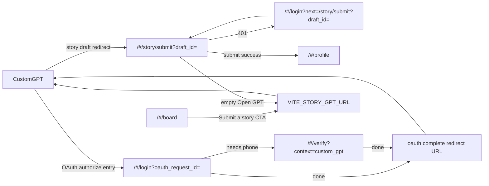

# SPA URL & page map

**Status:** persistent reference  
**As-of:** 2026-10-09T17:50:00Z · NS-06 default entry flip (`pkg-000102`)  
**SSOT code:** [`src/App.jsx`](../src/App.jsx) · [`src/router/sessionRoutePolicy.js`](../src/router/sessionRoutePolicy.js) · [`src/main.jsx`](../src/main.jsx) (`HashRouter`)  
**Related:** [deploy-guide.md](./deploy-guide.md) (env / Railway) · [UAT MVP brief](./uat/UAT-MVP-BRIEF.md) (product UAT, без кода) · [storyGptUrl.js](../src/config/storyGptUrl.js) · [storyHandoffFlowState.js](../src/auth/storyHandoffFlowState.js) · [gptBridgeFlowState.js](../src/auth/gptBridgeFlowState.js) · [arch 03 verify](./architecture/feed-visual-redesign-phase-1/03-verify-shelter-retire.md)

Справочник всех **маршрутов SPA**, точек входа и query-параметров, которые реально читает код. Без секретов `.env` и без выдуманных `return_to`-параметров.

**UAT (product):** стартовый brief и findings → [uat/UAT-MVP-BRIEF.md](./uat/UAT-MVP-BRIEF.md) · [uat/UAT-FINDINGS-TEMPLATE.md](./uat/UAT-FINDINGS-TEMPLATE.md).

---

## 1. Конвенции URL

| Правило | Факт |
|---------|------|
| Роутер | `HashRouter` — канон `https://{SPA_ORIGIN}/#/{path}[?query]` |
| Без `#` | `https://{SPA_ORIGIN}/board` **не** обслуживается роутером SPA |
| Public | `/`, `/board`, `/how-it-works`, `/login`, `/issue/*`, `/next/feed`, `/next/feed/issue/:id` |
| Protected | `/dashboard`, `/profile`, `/verify`, `/story/submit`, `/story/compose` (+ prefixes) |
| Без сессии на protected | SessionShell overlay; Sign In → `/login` (см. deploy-guide) |
| Fallback | неизвестный path → `/next/feed` (NS-06 Q8) |
| Product home | `#/next/feed` — next shell host (feed body → next-feed package) |
| Classic shelter | `#/board`, `#/issue/:id` — residual list/detail; **not** product home |

**Локально:** `http://127.0.0.1:4173/#/...` или `http://127.0.0.1:5173/#/...`  
**Prod pattern:** `https://{spa}.railway.app/#/...` (конкретный origin назначает Railway)

Backend для данных страниц: gateway (`VITE_GATEWAY_BASE_URL`), identity (`VITE_IDENTITY_BASE_URL`) — см. [deploy-guide.md](./deploy-guide.md).

---

## 2. Карта маршрутов

Полный URL = `{SPA_ORIGIN}/#{path}` (query после path внутри hash, напр. `/#/story/submit?draft_id=…`).

| Path | Component | Access | Назначение | Query (код) |
|------|-----------|--------|------------|-------------|
| `/` | `Navigate` → `/next/feed` | public | default entry (NS-06) | — |
| `/next/feed` | `NextFeedHostPage` | public | next shell host + WIP feed placeholder (body → next-feed) | — |
| `/next/feed/issue/:id` | `NextFeedHostPage` | public | next shell issue host (WIP; body → next-feed) | `:id` path param |
| `/board` | `BoardPage` | public | classic shelter-list (residual feed data); next-shell chrome (NS-05) | — |
| `/how-it-works` | `HowItWorksPage` | public | 4 шага + Submit → GPT CTA | — |
| `/issue/:id` | `IssuePage` | public | classic Issue detail shelter; next-shell chrome (NS-05) | `:id` path param |
| `/login` | `LoginPage` | public | email/password (и GPT OAuth bridge) | см. §4 |
| `/dashboard` | `DashboardPage` | protected | workspace dashboard + CivicStatus → `/verify` | — |
| `/profile` | `ProtectedProfilePage` → `UserCabinetPage` | protected | User Cabinet (Account / Civic / Story / Wallet / Contribution) | — |
| `/verify` | `VerifyPage` | protected | phone / civic verify; waitlist; GPT bridge verify host | `context`, `dev_gpt_phase` |
| `/story/submit` | `StorySubmitPage` | protected | **онбординг / handoff черновика из Custom GPT** | `draft_id`, `dev_handoff_phase` |
| `/story/compose` | `Navigate` → `/story/submit` + тот же `search` | protected | legacy alias | любой search → submit |
| `*` | `Navigate` → `/next/feed` | — | catch-all (NS-06) | — |

---

## 3. Точки входа (flows)



Два разных GPT-контура (не смешивать):

1. **Story draft handoff** — черновик истории → `/story/submit?draft_id=`  
2. **GPT OAuth bridge** — authorize Custom GPT app → `/login?oauth_request_id=` (+ verify с `context=custom_gpt`)

---

## 4. Custom GPT → SPA (story draft handoff)

Источник: [`StorySubmitPage.jsx`](../src/pages/StorySubmitPage.jsx), [`storyHandoffFlowState.js`](../src/auth/storyHandoffFlowState.js).

### Вход (redirect из GPT)

```
https://{SPA_ORIGIN}/#/story/submit?draft_id={DRAFT_ID}
```

| Элемент | Поведение |
|---------|-----------|
| `draft_id` | читается из query; пишется в `sessionStorage` key `dogestonia.story_handoff.draft_id` |
| без `draft_id` | фаза `empty` + CTA «Open GPT» |
| protected | без сессии → overlay / login с возвратом |

**Login loop (сохранение возврата на handoff):**

```
/#/login?next=%2Fstory%2Fsubmit%3Fdraft_id%3D{DRAFT_ID}
```

Строит `buildHandoffLoginPath(draftId)` → `/login?next=` + encoded `/story/submit?draft_id=…`.  
После успеха: `resolveHandoffReturnPath(next | redirect)`; если нет/unsafe → `/board` (**honest residual** — handoff default in `storyHandoffFlowState.js` still `/board`; product home remains `#/next/feed` after NS-06 entry flip).

### Возврат обратно в Custom GPT

В **inbound** URL SPA **нет** отдельного query вроде `return_to` / `gpt_return` для возврата в GPT.

Возврат наружу = **`VITE_STORY_GPT_URL`** (build-time), через [`getStoryGptHref` / `openStoryGpt`](../src/config/storyGptUrl.js):

| Место | Поведение |
|-------|-----------|
| Header / Board / How it works «Submit a story» | `href = getStoryGptHref()` (`#` если env пуст) |
| `/story/submit` empty → Open GPT | тот же `VITE_STORY_GPT_URL` |
| Env пуст | calm fail: `#` / no-op open |

Пример outbound (значение задаётся в env, не хардкод в продукте):

```
https://chatgpt.com/g/{your-custom-gpt-id}
```

### Фазы handoff UI (`data-story-handoff-phase`)

`resolving` · `login_required` · `preview` · `verify` · `submitting` · `submitted` · `expired` · `service_down` · `empty`

Успешный submit → `navigate('/profile', { state: { submittedStoryId } })`.

### DEV-only

`/#/story/submit?dev_handoff_phase={phase}` — только если `phase` ∈ `STORY_HANDOFF_PHASES`.

Legacy: `/#/story/compose?draft_id=…` → `/#/story/submit?draft_id=…`.

---

## 5. Custom GPT OAuth bridge (отдельный вход)

Источник: [`LoginPage.jsx`](../src/pages/LoginPage.jsx), [`VerifyPage.jsx`](../src/pages/VerifyPage.jsx), [`gptBridgeFlowState.js`](../src/auth/gptBridgeFlowState.js).

| URL | Назначение |
|-----|------------|
| `/#/login?oauth_request_id={id}` | вход OAuth authorize; id → `sessionStorage` `dogestonia.oauth_request_id` |
| `/#/verify?context=custom_gpt` | verify host в контексте GPT bridge (`GPT_BRIDGE_CONTEXT`) |
| post-complete | `oauthService.completeOAuthAuthorize` → `redirect` **location** (ChatGPT callback) — это возврат в GPT для OAuth, не `VITE_STORY_GPT_URL` |

DEV: `dev_gpt_phase`, `dev_auth_state`, `dev_error_code` на login/verify.

---

## 6. Login query (сводка)

| Param | Использование |
|-------|----------------|
| `next` | post-auth return path (приоритет); должен начинаться с `/`, не `//` |
| `redirect` | alias / fallback для return path |
| `oauth_request_id` | GPT OAuth bridge entry |
| `dev_auth_state` | DEV mock auth page state |
| `dev_error_code` | DEV mock error |
| `dev_gpt_phase` | DEV GPT bridge phase |

Default return без `next`/`redirect`: `/board` (**handoff/auth residual** — not product home; see §8).

---

## 7. Verify query (сводка)

| Param | Использование |
|-------|----------------|
| `context=custom_gpt` | GPT bridge verify host |
| `dev_gpt_phase` | DEV bridge success / already_verified panels |

---

## 8. Быстрый чеклист оператора

| Цель | Открыть |
|------|---------|
| Public home / feed (product) | `/#/next/feed` |
| Classic shelter board (residual) | `/#/board` |
| How it works | `/#/how-it-works` |
| Issue (classic shelter) | `/#/issue/{id}` |
| Sign in | `/#/login` |
| Cabinet | `/#/profile` (нужна сессия) |
| Phone verify | `/#/verify` |
| Dashboard | `/#/dashboard` |
| GPT story onboarding | `/#/story/submit?draft_id={id}` |
| Начать историю в GPT | CTA Submit → `VITE_STORY_GPT_URL` |
| GPT OAuth login | `/#/login?oauth_request_id={id}` |
| Handoff return без `next`/`redirect` | `/#/board` (code default · residual) |

---

## 9. Out of scope этого справочника

- Pixel / mockup / story-root gate screenshots  
- Значения секретов и конкретный GPT-id из `.env`  
- Backend OpenAPI (только FE route map)
