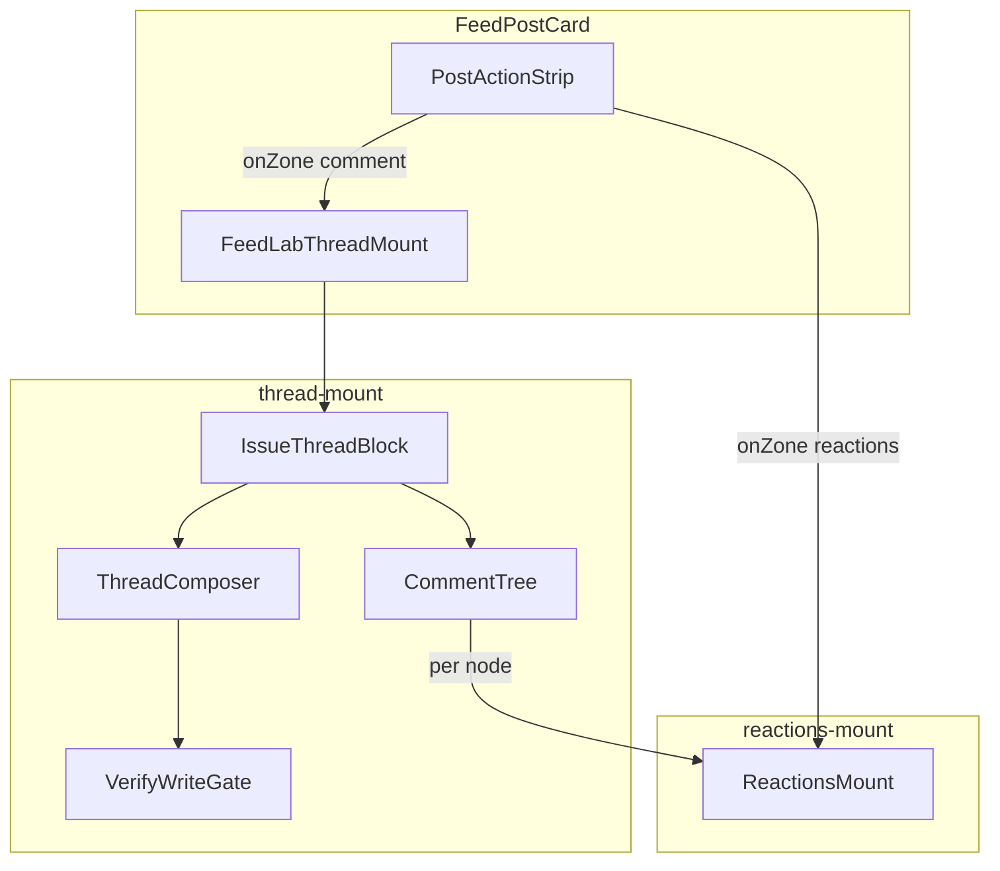

# Architecture — component-thread / `thread-mount` (Phase 1.5)

> **UTC:** 2026-10-22 (rev · §19 CT-33 composer residual · §18 CT-32 · §17 CT-31 policy A · §16 CT-30 · prior CT-28…29) · prior CT-25…27 · CT-21…24 · CT-16…20  
> **Package:** [INDEX.md](INDEX.md) · [BRIEF](PRODUCT-BRIEF.md) · [interview NF-21+](../next-feed/INTERVIEW-NF-21-plus-op-residual-spa-wide-2026-10-22.md) · [interview NF-18+](../next-feed/INTERVIEW-NF-18-plus-op-residual-map-dark-2026-10-21.md) · [interview NF-17+](../next-feed/INTERVIEW-NF-17-plus-op-residual-chrome-attach-2026-10-21.md) · [interview CT-28+](INTERVIEW-CT-28-plus-next-feed-cutover-2026-10-20.md)  
> **Human guide:** [ARCHITECTURE-human-guide.md](ARCHITECTURE-human-guide.md)  
> **Status:** CT-01…32 structure Present/Partial · **CT-33 L1/L1.5/L2 Ready** (Markstack docs · Await Apply)

---

## 1. Goals

1. Pluggable discussion block usable under a post first, then other hosts.  
2. Same host-orchestration grammar as reactions: strip zone → host → package surface.  
3. Configurable limits: `max_depth`, `maxAttachments`, `previewNodeBudget` (and media allow-list) — **not** JSX magic numbers.  
4. Reactions remain a peer package plugged into comment nodes.

---

## 2. Paradigm extracted from code (AS-IS → TO-BE)

### 2.1 Reactions paradigm (keep)

| Pattern | AS-IS fact | Thread analogue |
|---------|------------|-----------------|
| Feature package | `src/features/reactions-mount/` | `src/features/thread-mount/` |
| Lab thin host | `FeedLabReactionsMount` + FixtureAdapter | `FeedLabThreadMount` + FixtureAdapter |
| Strip dumb | `FeedPostActionStrip` fires `onZone` | unchanged |
| Host orchestrates | `handleZone('reactions')` → `apiRef` | `handleZone('comment')` → thread expand/focus / `apiRef` |
| Surfaces inside package | ReactorsPopover inside mount | Composer/gate/tree inside ThreadMount |
| Multi-target | `target=thread-root\|comment` | `hostKind=post\|modal\|…` (post first) |

### 2.2 Lab discussion AS-IS (evolve)

Current `feed-lab/post/discussion/*` is a **tip plane** (collapsed/expanded). CT-08 cutover replaces it with ThreadMount composition while preserving Comment-zone expand/focus behavior.

### 2.3 Dual stacks (do not merge)

| Stack | Role |
|-------|------|
| Lab greenfield | `thread-mount` + `feed-lab` |
| Product next-feed VL | `features/feed/comments|composer|verify` — reference only |
| Classic board | `components/threads/*` — prior skin reference |

---

## 3. Package shape (acceptance target)

```text
src/features/thread-mount/
  index.js                 # public API
  ThreadMount.jsx          # root orchestrator (state + slots)
  IssueThreadBlock.jsx     # M152 state chrome
  tree/
    CommentTree.jsx
    CommentNode.jsx
  composer/
    ThreadComposer.jsx
    AttachmentRef.jsx
  verify/
    VerifyWriteGate.jsx    # lab presentation · stub handoff
  adapters/
    FixtureAdapter.js
    LiveAdapter.js         # fail-closed until wired
  config/
    threadMountConfig.js   # DEFAULT_MAX_DEPTH · DEFAULT_MAX_ATTACHMENTS · resolve*
  slot/
    threadHostSlot.js      # hostKind · slot kinds
```

Lab:

```text
src/features/feed-lab/post/thread/FeedLabThreadMount.jsx
```

---

## 4. Public contracts

### 4.1 ThreadMount props (conceptual)

| Prop | Role |
|------|------|
| `status` | `loading\|empty\|populated\|unavailable` (M152) |
| `expanded` / `onExpandedChange` | collapsed ↔ expanded |
| `comments` | tree nodes `{ id, parentId, depth, body, … }` |
| `maxDepth` | reply eligibility ceiling |
| `maxAttachments` | per-composer pending attach intents ceiling |
| `mediaAllowedTypes` | attach allow-list (fixture/knobs) |
| `writeCapability` | `allowed\|unverified\|denied-unknown\|…` (drives M157) |
| `onPostComment` / `onRetry` | adapter writes |
| `reactionSlot` / render prop | inject `ReactionsMount` per node (CT-09) |
| `apiRef` | optional `{ expand, focusComposer, setReplyTarget }` for strip Comment |

### 4.2 Config constants (CT-05 / CT-03)

```js
// threadMountConfig.js — single source; FixtureAdapter may override per stand
export const DEFAULT_MAX_DEPTH = 3        // reply eligibility (knobs may override)
export const DEFAULT_MAX_ATTACHMENTS = 1  // pending intents per composer instance
export const VISUAL_INDENT_CAP = 3        // CSS levels — independent of maxDepth
```

Rules:

- `VISUAL_INDENT_CAP` ≠ `maxDepth` (M153 §B).  
- `maxAttachments` read from props/config/knobs — **never** `if (files.length > 1)` literal without named constant.  
- Node-level override allowed: `maxAttachments` prop on ThreadMount / composer.

### 4.3 Adapter

| Method | Fixture | Live (later) |
|--------|---------|--------------|
| `snapshot()` | status · comments · knobs | map threads read |
| `postComment` | local append / failNext | ThreadsSocialClient |
| `list` / load | fixture states A–E | fail-closed if absent |
| `writeCapability` | fixture unverified/verified | opaque identity outcome |

No invent upload API: AttachmentRef = **local intent** until bind contract exists.

---

## 5. Host integration (post first)



**Comment zone:** host calls `threadApiRef.expand()+focusComposer()` (or equivalent state) — does **not** import tree internals into strip.

**Future hosts:** pass same ThreadMount with different `hostKind` / layout chrome; do not fork package.

---

## 6. State ownership

| State | Owner |
|-------|-------|
| M152 A–D status | ThreadMount / adapter snapshot |
| expanded | host or ThreadMount controlled prop |
| reply target · draft | ThreadComposer |
| pending attachments | ThreadComposer / AttachmentRef (count ≤ maxAttachments) |
| verify gate visibility | writeCapability + composer intent |
| reaction open | reactions-mount only |

---

## 7. Lab M157 (variant A)

- Fixture `writeCapability: 'unverified'` → show gate chrome.  
- Primary CTA → stub navigation to `/verify` **or** lab stand that simulates return (no method UI).  
- On stub «verified» return: restore draft/target · show Verified · user must press Post.  
- Bare fail/403 fixture → WRITE-DENIED-UNKNOWN · **no** auto `/verify`.  
- Reference: `features/feed/verify/VerifyWriteGate.jsx` for copy/structure — reimplement greenfield under thread-mount (or thin wrap) without importing banned product FeedDiscussionBlock into lab Done path.

---

## 8. Cutover rules (CT-08)

1. Card/detail render FeedLabThreadMount instead of FeedDiscussionPlane (or plane becomes thin wrapper).  
2. Preserve `data-lab-*` markers for tests; add `data-lab-thread-mount`.  
3. Fixtures gain status variants for A–E stands.  
4. Do not delete classic/product stacks in this wave.

---

## 9. Testing seams

- Vitest: status matrix · nest/reply eligibility · maxAttachments clamp · gate states · Comment zone ≠ picker.  
- OP eye: M152 C literal bodies · M153 nest · M157 gate.  
- No invent OP PASS.

---

## 10. Forbidden architecture moves

- Thread package importing/owning ReactorsPopover  
- Hardcoding attach/depth limits outside `threadMountConfig` / props  
- Invent branch-fetch HTTP for CT-06  
- Dual controllers: strip Comment AND composer both fighting expand without single apiRef/state  
- Copy-paste classic IssueThreadBlock into lab without greenfield tokens

---

## 11. Residual chrome locks (CT-10…15 · 2026-10-19)

> Source: [ux-gaps analysis](../../../analysis/analysis-component-thread-m152-m153-ux-gaps-2026-10-19.md) · [OP-UX residual](OP-UX-MIRROR-m152-m153-ux-gaps-residual-2026-10-19.md)  
> Structure paradigm §§1–9 **hold**. This section only adds placement/chrome ownership.

### 11.1 Empty: entry-only (CT-10 · G-H1)

| Rule | Owner |
|------|-------|
| `status=empty` first paint → `composerEntry` / entry pill only | `ThreadMount` `showComposer` / `composerEntry` split |
| Full `ThreadComposer` **not** mounted on empty first paint | same |
| Empty speech icon | `IssueThreadBlock` empty chrome |

AS-IS bug to close: `showComposer = writeAllowed && (expanded \|\| status === 'empty')` — remove empty from full-composer OR gate behind entry activate.

### 11.2 Composer mount: root bottom vs reply under node (CT-12 · G-H4)

```text
ThreadMount
├─ IssueThreadBlock
│   └─ CommentTree
│       └─ CommentNode
│           ├─ bubble · actions
│           ├─ [replySlot] ThreadComposer mode=reply   ← when replyTarget === node.id
│           └─ children…
└─ [rootSlot] ThreadComposer mode=root                 ← no replyTarget · bottom OK
```

| Mode | Mount |
|------|-------|
| Root compose | Sibling after block (or dedicated root slot at tree foot) |
| Reply compose | **Slot / portal under parent `CommentNode`** · not after entire forest |

Single owner: `replyTarget` + draft remain ThreadMount/ThreadComposer state; tree only provides mount point (`renderReplyComposer` / children slot).

### 11.3 Comment actions chrome (CT-13 · G-H5)

| Control | Ownership |
|---------|-----------|
| React pill chrome | Thread CSS wrap around host `renderCommentReactions` · reactions-mount still owns open/picker |
| Reply pill | `CommentNode` · icon+label · calls `onReply(nodeId)` |
| Separator | CommentNode CSS |
| People / picker | **Forbidden** in thread-mount |

Density: compact pills — do not render full strip DNA (`ReactionSummaryStrip` post-width) as comment action row.

### 11.4 Composer icons (CT-11 · G-H2 · G-H6)

| Control | Asset (Present) | Grammar |
|---------|-----------------|---------|
| Attach | `public/icons/next-feed/actions/attach.svg` | paperclip · left / discoverable |
| Empty send | `send.svg` | yellow **circle** |
| Post comment/reply | `send.svg` + label | yellow labelled + plane |
| Reply action (node) | `reply.svg` | CT-13 |

No silent invent SVG. Attach logic (`attachmentsAvailable` / AttachmentRef) **hold** — chrome only.

### 11.5 Spine + bubbles (CT-14 · G-H7 · G-H8)

| Concern | Owner |
|---------|-------|
| Continuous vertical rail + L-elbows | `CommentTree.css` / `CommentNode` connector — **not** only `indent > 0` fragment |
| Bubble wash / padding / action gaps | `CommentNode.css` tokens (light blue-grey M153 tone) |
| Nest visible on feed | `labFeedFixtures` ≥1 card depth≥1 |

`VISUAL_INDENT_CAP` ≠ `maxDepth` unchanged.

### 11.6 Lab host residual (CT-15 · G-M2…M4 · G-L5)

| Prop / chrome | Rule |
|---------------|------|
| `narrow` | FeedPostCard / stands pass for 390 stress |
| `branchDisclosure` | `true` when fixture needs collapsed branches |
| Residents row | Only if reactions aggregate **confirmed** · else omit |
| Heading issue id | `Discussion · Issue {id}` when host/fixture provides id |

### 11.7 Story → arch map

| Story | Arch § |
|-------|--------|
| CT-10 | 11.1 |
| CT-11 | 11.4 |
| CT-12 | 11.2 |
| CT-13 | 11.3 |
| CT-14 | 11.5 |
| CT-15 | 11.6 |

---

## 12. M153a/b gap locks (CT-16…20 · 2026-10-20)

> Source: [puppeteer gaps](../../../analysis/analysis-lab-feed-thread-puppeteer-gaps-2026-10-20.md) · [M153a/b OP mirror](OP-UX-MIRROR-m153a-m153b-thread-gaps-2026-10-20.md) · [M153b](../../../UX/next/feed/artboards/DOGEstonia-M153b-depth-2-thread-token-callouts-spec-v1.0.md) · [M153a v1.1](../../../UX/next/feed/artboards/DOGEstonia-M153a-attachment-picker-residual-state-sheet-spec-v1.1.md)  
> §§1–11 **hold**. This section adds post ownership + attach residual + token SSOT pointers.

### 12.1 Post comment write ownership (CT-16)

| Rule | Owner |
|------|-------|
| Successful post/reply appends a comment **once** | Single write-owner |
| Host snap path (`onCommentsChange` / FeedLab) | Host owns list · ThreadMount must **not** also local-append same id |
| ThreadMount local path | ThreadMount owns list · host must **not** also snap-append same id |
| Dual-append → `duplicate-id` → flat forest | **Forbidden** AS-IS bug (BUG-1) |

### 12.2 Attachment picker residual (CT-17)

| Rule | Owner |
|------|-------|
| First paint zero chips | ThreadComposer |
| Attach → OS/native picker only | ThreadComposer · no custom file manager |
| Family allow-list images/PDF/Office | Config hook · exact MIME **TBD** (no invent) |
| Ready/Denied = local intent | AttachmentRef · never published URL claim |
| `attachmentsAvailable=false` | Omit Attach · no seeded Denied |
| Paint tokens for chips | **CT-19** / M153b §7 (not this section’s behavior) |

### 12.3 Depth-2 visual tokens (CT-18 · CT-19)

| Atom | SSOT | Story |
|------|------|-------|
| Bubble · spine · pills ≥44 · reply parent | M153b §§3–6 · implement in **px** | CT-18 |
| AttachmentRef Ready/Denied paint | M153b §7 · M153a C–E copy | CT-19 |
| Comment reaction **summary** redesign | HOLD | no story |

CT-13/CT-14 structure remain; visual targets for A–D / §7 superseded by M153b.

### 12.4 Lab audit reachability (CT-20)

| Concern | Rule |
|---------|------|
| loading / empty / unavailable | Reachable stands on `#/lab/feed` |
| post-fail · attach-off · depth≥maxDepth | Reachable fixtures |
| Harness | Assert CT-16 unique ids · CT-17 native picker · no synthetic-only Ready |

### 12.5 Story → arch map (CT-16…20)

| Story | Arch § |
|-------|--------|
| CT-16 | 12.1 |
| CT-17 | 12.2 |
| CT-18 | 12.3 |
| CT-19 | 12.3 |
| CT-20 | 12.4 |

---

## 13. CT-21…24 interview locks (2026-10-20) — L1.5

> Source: [INTERVIEW-CT-21-plus…](INTERVIEW-CT-21-plus-thread-density-share-attach-2026-10-20.md) · [UX-PROMPTS preview/share](UX-PROMPTS-thread-preview-budget-and-share-2026-10-20.md)  
> §§1–12 **hold** except where this section **supersedes** feed-card collapsed default and Discussion heading.

### 13.1 Preview node budget · default expanded · no heading (CT-21)

| Rule | Owner |
|------|-------|
| Feed-card default | **Expanded** populated tree (not M152-C collapsed summary) |
| `previewNodeBudget` | Named knob · `DEFAULT_PREVIEW_NODE_BUDGET = 3` · resolve like `maxDepth` |
| Count unit | Forest **nodes** · **depth-first** (parent → children → next root) |
| Over budget | Truncate + **`Show more comments`** · **one-shot** reveal all remaining |
| Heading `Discussion · Issue {id}` / `Discussion` | **Omit** on all package mounts |
| Artboard tip | [M152c](../../../UX/next/feed/artboards/DOGEstonia-M152c-thread-first-paint-expand-truncate-spec-v1.0.md) |

Supersedes CT-15 FR heading-on-card for this surface. Collapsed 2-body preview is no longer feed-card default.

### 13.2 Comment attachment preview (CT-22)

| Rule | Owner |
|------|-------|
| Post persists attachment intents on comment | Host / ThreadMount lab path |
| Node render | `CommentNode` — image preview · non-image type cue |
| No published URL | **Local** preview + honesty |
| Allow-list | Existing families + **`.md`** · MIME TBD no invent |
| Denied | Not shown as success media on node |

### 13.3 Density · artboard frames only (CT-23)

| Rule | Owner |
|------|-------|
| Extra host/section plates | Remove if absent from M152/M153/M153b |
| Keep | M153b bubble 1px border · spine · pills · composer |
| Spacing | Artboard rhythm only · no denser invent |

### 13.4 Share Issue link sheet (CT-24)

| Rule | Owner |
|------|-------|
| Strip `share` zone | Custom UI — not no-op · not OS share hybrid |
| Desktop / narrow | Popover / bottom sheet ([M152d](../../../UX/next/feed/artboards/DOGEstonia-M152d-post-share-residual-states-spec-v1.0.md)) |
| Rows | Telegram · Instagram · X · WhatsApp · Facebook · Copy link |
| Icons | `/icons/next-feed/share/{telegram,instagram,x,whatsapp,facebook}.svg` |
| Payload | Canonical public Issue URL (M152) |
| Lab missing URL | Honesty copy from M152d D |
| Copy success | `Link copied` · handoff ≠ delivered |
| Instagram | Copy-link fallback · no invent private API |

### 13.5 Story → arch map (CT-21…24)

| Story | Arch § |
|-------|--------|
| CT-21 | 13.1 |
| CT-22 | 13.2 |
| CT-23 | 13.3 |
| CT-24 | 13.4 |

### 13.6 Layer map (delivery class)

| Layer | Meaning | Artifact |
|-------|---------|----------|
| **L1** | Product FR/AC · out of scope · DoD | Backlog `STORY-SPA-CT-*.md` |
| **L1.5** | Architecture locks · ownership | This §13 (+ prior §§) |
| **L2** | Technical subtasks Await Apply | Story task tables |

---

## 14. CT-25…27 manual-test residual (2026-10-20 evening) — L1.5

> Source: [INTERVIEW-CT-25-plus…](INTERVIEW-CT-25-plus-attach-density-share-residual-2026-10-20.md) · [UX-PROMPTS](UX-PROMPTS-thread-attach-chip-and-density-v2-2026-10-20.md) · [intake M153c/d](../../../analysis/analysis-m153c-m153d-generation-intake-2026-10-20.md) PASS  
> §§1–13 **hold** except where this section **supersedes** §13.3 border-keep and §13.4 Instagram copy-fallback.

### 14.1 Composer AttachmentRef preview + filename (CT-25)

| Rule | Owner |
|------|-------|
| Image Ready chip | Local thumb **48 × 48 CSS px** (object URL) **or** clear image icon — ▣ alone insufficient |
| Filename | Show `intent.fileName` / File.name · family secondary **above** · middle ellipsis (begin + ext) |
| Non-image | Type cue (`MD` / `PDF` / `Word`) + filename |
| Paint | M153c §7 / M153b §7 Ready/Denied · honesty · Remove |
| Artboard | [M153c](../../../UX/next/feed/artboards/DOGEstonia-M153c-composer-attachment-filename-chip-spec-v1.0.md) · intake PASS |

### 14.2 Density v2 borderless fill (CT-26)

| Rule | Owner |
|------|-------|
| Bubble | **No** outer border · fill `#F7F6F2` · r12 · pad **8v / 12h** |
| React/Reply group | **No** outer border · fill `#FFFDF8` · pad **4v / 8h** · min-height **44** · sep 1×16 `#E7E4DC` |
| Spacing | Bubble→actions **4 px** · node→next **8 px** |
| Spine / L-elbow | Remain 1 px `#667085` · elbow r6 · parent stripe 3 px `#B54708` |
| AttachmentRef | Chip borders **retained** (M153c / M153b §7) |
| Supersedes | §13.3 “keep M153b bubble/pill border” |
| Artboard | [M153d](../../../UX/next/feed/artboards/DOGEstonia-M153d-comment-tree-density-v2-spec-v1.0.md) · intake PASS |

### 14.3 Share Instagram disabled · Copy text-only (CT-27)

| Rule | Owner |
|------|-------|
| Instagram | Listed · visually disabled · hint may remain · **click ≠ copy** |
| Copy | Only via **Copy link** row (and non-IG networks) |
| Copy link chrome | **Text-only** — no icon / no ⎘ |
| Supersedes | §13.4 Instagram copy-fallback on row click |

### 14.4 Story → arch map (CT-25…27)

| Story | Arch § |
|-------|--------|
| CT-25 | 14.1 |
| CT-26 | 14.2 |
| CT-27 | 14.3 |

---

## 15. `#/next/feed` cutover residual (2026-10-20) — L1.5

> Source: [INTERVIEW-CT-28-plus…](INTERVIEW-CT-28-plus-next-feed-cutover-2026-10-20.md) · [gap analysis](../../../analysis/analysis-next-feed-thread-reactions-cutover-2026-10-20.md)  
> Sibling reactions: [CR-23](../component-reactions/STORY-SPA-CR-23-next-feed-reactions-mount-live-cutover.md) · [CR ARCH §1](../component-reactions/ARCHITECTURE.md)  
> §§1–14 **hold** for lab. This section opens production host cutover (previously Forbidden as docs-wave invent).

### 15.1 ThreadMount Live on `#/next/feed` (CT-28)

| Rule | Owner |
|------|-------|
| Host | `#/next/feed*` mounts (list opens issue · modal/sheet/route) |
| Presentation Done | `thread-mount` (not `FeedDiscussionBlock`) |
| Data | Existing `ThreadsSocialClient` only · bind `LiveAdapter` (replace `live-adapter-unwired`) |
| Lab | `#/lab/feed` FixtureAdapter **unchanged** |
| Attach | No invent upload/bind HTTP |

### 15.2 Civic media stub (CT-29)

| Rule | Owner |
|------|-------|
| Asset | Single `/assets/dogefeed.png` (lab stub path) |
| Surfaces | List + detail civic cards on `#/next/feed` |
| Supersedes | M150 `no-media` Done claim for interim until image-gen |
| Gen | No invent image-gen HTTP · no UX gen sheet |

### 15.3 Story → arch map (CT-28…29 · CR-23)

| Story | Arch § |
|-------|--------|
| CT-28 | 15.1 |
| CT-29 | 15.2 |
| CR-23 | component-reactions ARCH §1 |

---

## 16. Live attachment upload + tree map (CT-30) — L1.5 · 2026-10-21

> Source: [INTERVIEW-NF-13-plus…](../next-feed/INTERVIEW-NF-13-plus-live-civic-residual-2026-10-21.md) M5 · **W2 superseded** (blob in REQ-05) · threads [REQ-05](../../../../../doge-threads/docs/requirements/05-comment-attachment-refs-in-tree-read.md) · [HTTP-08](../../../../../doge-threads/docs/tasks/backlog-stories/02-public-social-http/STORY-THREADS-HTTP-08-attachment-blob-upload.md) · [HTTP-07](../../../../../doge-threads/docs/tasks/backlog-stories/02-public-social-http/STORY-THREADS-HTTP-07-tree-attachment-refs-read.md)  
> §§1–15 hold. **Supersedes** §15.1 “Attach: no invent upload/bind” and earlier §16 attachRef-only / blob-Open draft.

### 16.1 Live post → uploadAttachment

| Rule | Owner |
|------|-------|
| After create/reply ok | `ThreadsSocialClient.uploadAttachment` per Ready File + `comment_id` |
| HTTP | Exact `POST /threads/issues/{issue_id}/attachments` (multipart) |
| Handler/op (threads) | `handle_create_attachment` / `write_attachment` |
| `attachRef` | Remain for non-byte/seed — **not** primary Live path |
| Floor deny | Soft-fail attach · comment body success held |
| Lab | FixtureAdapter unchanged |

### 16.2 Tree map → CT-22 preview

| Rule | Owner |
|------|-------|
| Depends | HTTP-07: `comments[].attachments[]` with `published_url` |
| Mapper | `mapThreadTreeToBlock` → `publishedUrl` ← `published_url` |
| Null url | Honesty / type cue (CT-22) — no invent CDN |

### 16.3 Story → arch map

| Story | Arch § |
|-------|--------|
| CT-30 | 16.1 · 16.2 |
| HTTP-08 | threads REQ-05 §3 upload |
| HTTP-07 | threads REQ-05 §3 tree |

---

## 17. Live attach preview consumable (CT-31) — L1.5 · policy A · 2026-10-21

> Source: [INTERVIEW-NF-17-plus…](../next-feed/INTERVIEW-NF-17-plus-op-residual-chrome-attach-2026-10-21.md) **A6** · [analysis residual](../../../analysis/analysis-next-feed-op-residual-after-apply-2026-10-21.md) mark 6 · [§17 note](../../../analysis/architecture/next-feed-vl/17-live-attach-preview-consumable.md)  
> §§1–16 hold for upload/map. **Supersedes** §16.2 implication that mapping `published_url` into bare `` completes Live preview E2E.

### 17.1 Browser-consumable bytes

| Rule | Owner |
|------|-------|
| Symptom | GET attach requires Bearer · bare `` → 401 |
| Outcome | Citizen sees image when tree has image `published_url` |
| Policy | **A locked** (P1.3 APPLY · P3 Present) · **no invent B** |
| **A** (locked) | SPA authenticated fetch → blob → objectURL in `CommentAttachmentPreview` · Live `getThreadsAccessToken` via `FeedThreadMount` → `ThreadMount.getAccessToken` |
| **B** | Threads signed/public GET · sibling **HTTP-09** — **not chosen** · name ≠ create |
| Honesty | Null URL / floor deny / auth fail — CT-22 / CT-30.4 · `ATTACH_NODE_UNAVAILABLE_COPY` · no invent CDN |
| Lab | FixtureAdapter unchanged · omit `getAccessToken` · bare/local path held |

### 17.2 Story → arch map

| Story | Arch § |
|-------|--------|
| CT-31 | 17.1 |
| CT-30 | 16.1 · 16.2 (upload/map held) |
| HTTP-09 | Absent · policy B only (not chosen) |

---

## 18. Thread dark chrome residual (CT-32) — L1.5 · 2026-10-21

> Source: [INTERVIEW-NF-18-plus…](../next-feed/INTERVIEW-NF-18-plus-op-residual-map-dark-2026-10-21.md) **D5 · D6** · [wave2 evidence](../../../analysis/evidence/op-residual-wave2-2026-10-21/)  
> §§1–17 hold. **Supersedes** light-only `--tm-bubble-fill` / cream hex and bare `` glyphs as Done for dark readability.

### 18.1 Theme tokens + bubbles

| Rule | Owner |
|------|-------|
| Bubble / quote / composer fills | Theme tokens — not fixed `#f7f6f2` / cream |
| Link contrast | `--color-text-link` (or accent) Present under `[data-theme]` in `tokens.css` |
| Show more | Uses high-contrast link/accent token |
| Light | Readability held |

### 18.2 Glyphs (type · close · soft feed)

| Rule | Owner |
|------|-------|
| IssueTypeIcon | Theme-safe glyph (mask / currentColor) |
| FeedIssueMount Close | Theme-safe glyph |
| Soft feed action icons | Same pattern · next-feed components |
| Shell header/rail | **NS-07** (sibling · not this §) |

### 18.3 Story → arch map

| Story | Arch § |
|-------|--------|
| CT-32 | 18.1 · 18.2 |
| NS-07 | next-shell (shell icons) |
| NF-18 | next-feed strip density (not dark tokens) |

---

## 19. Composer / attach dark residual (CT-33) — L1.5 · 2026-10-22

> Source: [INTERVIEW-NF-21-plus…](../next-feed/INTERVIEW-NF-21-plus-op-residual-spa-wide-2026-10-22.md) **T5–6** · [wave3 evidence](../../../analysis/evidence/op-residual-wave3-2026-10-22/)  
> §§1–18 hold. **Extends** CT-32 where composer textarea / AttachmentRef / Post label still hardcode light fills.

### 19.1 Composer + attach plates

| Rule | Owner |
|------|-------|
| Textarea | Dark: readable typed text · themed fill (no white-on-white) |
| Attachment chips / preview | Theme tokens — not sole cream `#fffdf8` |
| Post label | Dark text on accent · readable |
| Attach control | Readable on dark |
| Light | Held |

### 19.2 Story → arch map

| Story | Arch § |
|-------|--------|
| CT-33 | 19.1 |
| CT-32 | 18 (structure Present · Partial eye leftover → CT-33) |
