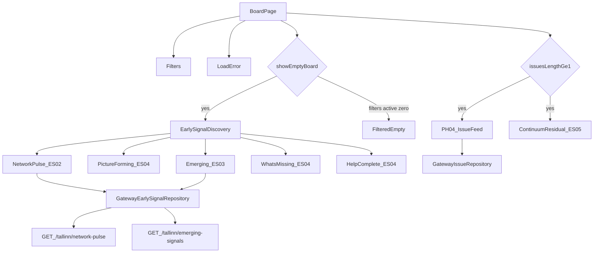

# ADMIN-ESD-06 — Technical decomposition + subtasks (слой 4.5)

## Meta

- **Key:** `ADMIN-ESD-06-tech-decomposition`
- **Status:** Done (2026-08-16)
- **Depends on:** ES-01…05 backlog stories Done-as-docs (ADMIN-ESD-05)
- **Skill:** architecture-designer + pipeline scaffold (Builder Queue P1.3 style)
- **Не запускает** `pkg-*` execute — только раскладка
- **Epic:** [EPIC-SPA-12-early-signal-dashboard](../../epics/EPIC-SPA-12-early-signal-dashboard/EPIC-SPA-12-early-signal-dashboard.md)

## Цель

Разложить каждую ES-стори на технические subtasks и materialize epic под Builder Queue. Зафиксировать **ADR FE** с аргументацией от кода (analysis.mdc).

## Prerequisite check

- [x] ADMIN-ESD-05 stories on disk (ES-01…05)
- [x] Board still hosted under AppShell / PH chrome (`BoardPage` + AppShell; no shell redesign in ES)
- [x] Sibling Pulse/Emerging contract decided — [STORY-SPA-ES-api-requirements.md](STORY-SPA-ES-api-requirements.md) bind/omit (REQ-49/50)

---

## Architecture decisions (ADR-lite, locked)

| ID | Decision | Argument (verified facts) |
|----|----------|---------------------------|
| **D1** | Host = **`/board` only**; branch inside `BoardPage` — no new route | PRODUCT-BRIEF #1; `App.jsx` `/` → `/board`; REQ-12 `/dashboard` out of scope |
| **D2** | Zero Issues (unfiltered) → discovery root `data-testid="board-early-signal-discovery"` instead of sole `board-empty`; **filtered-empty stays PH-04** | `showEmptyBoard` = `!loading && !error && !hasActiveBoardFilters && issues.length === 0` ([`BoardPage.jsx:161`](../../../../src/pages/BoardPage.jsx)); filtered path already separate |
| **D3** | UI under `src/components/earlySignal/*`, composed into `BoardPage` | Isolate Early Signal from PH Header/Footer; AppShell unchanged |
| **D4** | Data: `GatewayEarlySignalRepository` + thin `earlySignalService` — same `VITE_GATEWAY_BASE_URL` / `assertBaseUrl` pattern as [`GatewayIssueRepository.js`](../../../../src/repositories/GatewayIssueRepository.js) | Parity with Issues consumer; paths **only** `GET /tallinn/network-pulse` · `GET /tallinn/emerging-signals` (REQ-49/50); no invent |
| **D5** | Pulse + Emerging = **independent** fetches; failure → omit that block only | api-req §7; Issues list error path stays independent |
| **D6** | i18n: new `earlySignalDictionary.js` + `EARLY_SIGNAL_FLAT_KEYS` merged in [`dictionaries.js`](../../../../src/i18n/dictionaries.js) (cabinet/howItWorks pattern) — **not** into `publicHomeDictionary` | Namespace `earlySignal.*` locked ADMIN-05; package ownership |
| **D7** | Viz MVP = **CSS/SVG in-component**; no new chart library in ES-01…05 | api-req §5; avoid fake metrics icons as data |
| **D8** | Icon paths from [STORY-SPA-ES-icon-assets.md](STORY-SPA-ES-icon-assets.md); missing PNG **non-blocking** | catalog convention |
| **D9** | ES-05 continuum = PH-04 Issue **feed plus** residual discovery chrome; feed regression mandatory | AC-SPA-ES-05 / AC-SPA-ES-07 |
| **D10** | Forbidden copy: Vitest assert AC-SPA-ES-03 patterns against `earlySignal.*` dictionary values | REQ-15 §22–23 |



### Target module sketch (execute later — not created in this ADMIN)

| Module | Role |
|--------|------|
| `src/components/earlySignal/EarlySignalDiscovery.jsx` | Root shell + slots (ES-01) |
| `src/components/earlySignal/NetworkPulseBlock.jsx` | omit/bound (ES-02) |
| `src/components/earlySignal/EmergingSignalsBlock.jsx` | cards/empty (ES-03) |
| `src/components/earlySignal/PictureFormingBlock.jsx` | viz (ES-04) |
| `src/components/earlySignal/WhatsMissingBlock.jsx` | abstract gaps (ES-04) |
| `src/components/earlySignal/HelpCompleteBlock.jsx` | CTA → PH-06 helper (ES-04) |
| `src/components/earlySignal/ContinuumResidual.jsx` | compact residual (ES-05) |
| `src/repositories/GatewayEarlySignalRepository.js` | Pulse + Emerging HTTP |
| `src/services/earlySignalService.js` | thin service façade |
| `src/i18n/earlySignalDictionary.js` | `earlySignal.*` en/et/ru + FLAT_KEYS |

---

## Wave order (P1.3 / P3 later)

```
Wave 1: ES-01 shell + earlySignalDictionary bootstrap
Wave 2: ES-02 Pulse ∥ ES-03 Emerging (independent HTTP)
Wave 3: ES-04 Forming / Missing / Help (PH-06 CTA reuse)
Wave 4: ES-05 continuum residual + feed regression
```

---

## Subtask matrices (pipeline IDs)

> Folders under [`EPIC-SPA-12-early-signal-dashboard/stories/`](../../epics/EPIC-SPA-12-early-signal-dashboard/).  
> **ui_anchor** = first visual Path A task per story.

### ES-01 — Discovery shell

| Task | Folder | ui_anchor | Where to change (execute) |
|------|--------|-----------|---------------------------|
| T01 | `task-spa-es-01-t01-discovery-root-testid` | **yes** | `BoardPage.jsx` — branch `showEmptyBoard` → discovery root |
| T02 | `task-spa-es-01-t02-slot-layout-m136` | | `components/earlySignal/EarlySignalDiscovery.jsx` (+css) |
| T03 | `task-spa-es-01-t03-preserve-filtered-error` | | `BoardPage.jsx` — filtered-empty / load-error untouched |
| T04 | `task-spa-es-01-t04-l10n-discovery-keys` | | `earlySignalDictionary.js` + `dictionaries.js` bootstrap |
| T05 | `task-spa-es-01-t05-vitest-discovery-empty` | | `__tests__` — zero Issues → testid; filtered ≠ discovery |
| T06 | `task-spa-es-01-t06-story-gate-es-01` | | gate + screenshots |

### ES-02 — Network Pulse

| Task | Folder | ui_anchor | Where to change |
|------|--------|-----------|-----------------|
| T01 | `task-spa-es-02-t01-pulse-repository-service` | | `GatewayEarlySignalRepository` · `earlySignalService` — `GET /tallinn/network-pulse` |
| T02 | `task-spa-es-02-t02-pulse-omit-bound-ui` | **yes** | `NetworkPulseBlock.jsx` |
| T03 | `task-spa-es-02-t03-pulse-bind-map` | | bind map api-req §2.2; no Contributors |
| T04 | `task-spa-es-02-t04-pulse-icons` | | catalog `ic-pulse-*` paths |
| T05 | `task-spa-es-02-t05-vitest-pulse-honesty` | | omit on fail; no fabricated counts |
| T06 | `task-spa-es-02-t06-story-gate-es-02` | | gate |

### ES-03 — Emerging Signals

| Task | Folder | ui_anchor | Where to change |
|------|--------|-----------|-----------------|
| T01 | `task-spa-es-03-t01-emerging-repository` | | same repo — `GET /tallinn/emerging-signals` |
| T02 | `task-spa-es-03-t02-emerging-cards-empty` | **yes** | `EmergingSignalsBlock.jsx` |
| T03 | `task-spa-es-03-t03-emerging-icons` | | `ic-emerging-marker` / `ic-emerging-empty` |
| T04 | `task-spa-es-03-t04-vitest-emerging-shape` | | signals ≠ issues; empty honest |
| T05 | `task-spa-es-03-t05-story-gate-es-03` | | gate |

### ES-04 — Coverage + Help

| Task | Folder | ui_anchor | Where to change |
|------|--------|-----------|-----------------|
| T01 | `task-spa-es-04-t01-whats-missing-abstract` | **yes** | `WhatsMissingBlock.jsx` |
| T02 | `task-spa-es-04-t02-help-ph06-cta` | | `HelpCompleteBlock.jsx` + `storyGptUrl.js` |
| T03 | `task-spa-es-04-t03-picture-forming-viz` | | `PictureFormingBlock.jsx` CSS/SVG |
| T04 | `task-spa-es-04-t04-coverage-icons-mascot` | | catalog + `/assets/es-help-mascot.png` |
| T05 | `task-spa-es-04-t05-vitest-coverage-cta` | | no coverage %; CTA uses env |
| T06 | `task-spa-es-04-t06-story-gate-es-04` | | gate |

### ES-05 — Continuum

| Task | Folder | ui_anchor | Where to change |
|------|--------|-----------|-----------------|
| T01 | `task-spa-es-05-t01-continuum-layout` | **yes** | `BoardPage` + `ContinuumResidual.jsx` |
| T02 | `task-spa-es-05-t02-feed-regression` | | vitest/UI — Issues ≥1 feed intact |
| T03 | `task-spa-es-05-t03-residual-compact-slots` | | compact Pulse/Emerging/Missing |
| T04 | `task-spa-es-05-t04-rail-topic-icons` | | catalog rail/topic paths |
| T05 | `task-spa-es-05-t05-vitest-ac05-ac07` | | AC-SPA-ES-05/07; no Offers |
| T06 | `task-spa-es-05-t06-story-gate-es-05` | | gate |

---

## Explicit bans (every task)

- Invent gateway paths/fields
- Offers / Solutions on Pre-Cluster
- Voices / Contributors as Pulse KPI
- REQ-12 `/dashboard` changes
- Fabricated counts / «N Stories until Issue»
- Coverage % / gap score DTO

---

## Acceptance

- [x] Epic + task READMEs exist for all ES stories
- [x] No task invents gateway path
- [x] No task assumes Offers / Voices / REQ-12 changes
- [x] INDEX: ADMIN-ESD-06 → Done; package mode → «backlog ready for P1.3/P3»
- [x] ADR D1–D10 + wave order documented

## Как выполнять

«Выполни ADMIN-ESD-06: ADR + scaffold EPIC-SPA-12 и task decomposition для ES-01…05; не invent GW paths; не pkg execute».
