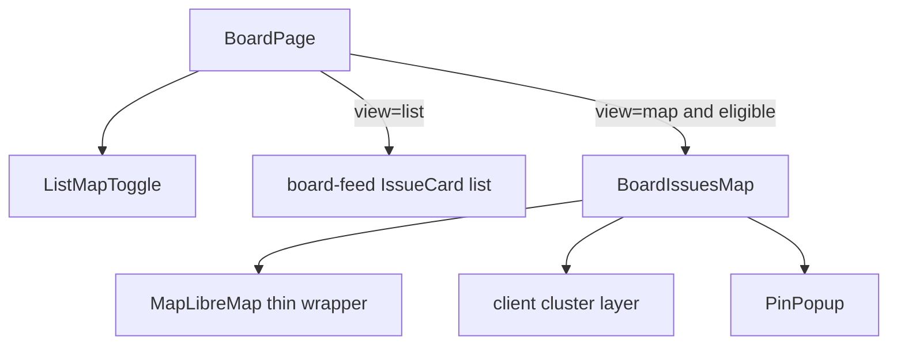

# ARCHITECTURE-SSR-03 — Board map + pins assemble

> **Status:** As-of-Done — map UI **implemented** in spa `src/` (P3 `pkg-000076` 2026-09-02)  
> **Story:** [STORY-SPA-SSR-03-board-list-map-toggle.md](STORY-SPA-SSR-03-board-list-map-toggle.md)  
> **Product locks (interview):** [ADR-SSR-03-map-library.md](ADR-SSR-03-map-library.md) D1–D8  
> **Mockup:** [M142](../../../UX/mockups/semantic-schema/mockup-142-board-list-map-toggle-state-sheet-spec.md)  
> **Epic tasks:** T00 · T01 · T02 · T05 (assemble); T03/T04/T06 adjacent  
> **REQ:** [16](../../../requirements/16-semantic-schema-spa-compatibility.md) §4.2 / §6 Q2

This document is the **assemble SSOT** for list|map on `/board`.  
**Do not** re-decide library/cost/UX here — that is ADR.  
**Do not** invent gateway endpoints or pack.json browser reads.

---

## 1. Verified host context (As-of-Done)

| Fact | Evidence |
|------|----------|
| Board page | [`BoardPage.jsx`](../../../../src/pages/BoardPage.jsx) — `boardView` list\|map + eligibility |
| Issues load | `issueService.getIssues` → [`GatewayIssueRepository.js`](../../../../src/repositories/GatewayIssueRepository.js) → `GET /node/issues` |
| Feed | `data-testid="board-feed"`; cards via [`IssueCard`](../../../../src/components/IssueCard/IssueCard.jsx) |
| Map modules | [`ListMapToggle`](../../../../src/components/map/ListMapToggle.jsx) · [`BoardIssuesMap`](../../../../src/components/map/BoardIssuesMap.jsx) · [`MapLibreMap`](../../../../src/components/map/MapLibreMap.jsx) |
| Map dep | `maplibre-gl` ^4.7.1 in [`package.json`](../../../../package.json) |
| Unfiltered empty | `showEmptyBoard` → `<EarlySignalDiscovery />` |
| Filtered empty | `data-testid="board-filtered-empty"` — PH-04 |
| Continuum | `<ContinuumResidual />` when Issues present — ES-05 |
| bbox keys | Future-only [`boardQuery.js`](../../../../src/router/boardQuery.js) — **OOS** this story |

Map mode must **compose into** this host without replacing discovery / filtered-empty / continuum semantics ([T06](../../epics/EPIC-SPA-13-semantic-schema-runtime/stories/STORY-SPA-SSR-03-board-list-map-toggle/task-spa-ssr-03-t06-ph04-es05-regression/README.md)).

---

## 2. Data contract

```text
resultset R = issues[] from current filters (same as list)
pin-capable P = { i in R | typeof geo.lat === number && typeof geo.lon === number }
Map eligible  <=> |P| >= 1
List always shows R (including issues not in P)
Map pins / clusters drawn from P only
```

- Public keys only: `geo.lat|lon|label|district|settlement|region|country|detail_level` — [api-req §2.2](STORY-SPA-SSR-api-requirements.md).  
- `detail_level` **does not** make a pin.  
- No `admin_*` on Issue wire.  
- Popup content: civic title + optional `geo.label` + Open CTA — **not** `structured_payload`, **not** pack fields outside `schema_card` (overlay is SSR-02).

---

## 3. Target component topology (P1.3)

Map code does not exist yet. Target seams (verify/adjust at execute):



| Module (target) | Responsibility | Task |
|-----------------|----------------|------|
| `BoardPage.jsx` | Own `view: list\|map` state; eligibility from `issues`; keep toolbar/filters; branch feed vs map | T01 · T03 · T04 |
| `ListMapToggle` (new, under board/ or BoardPage-local) | List\|Map chrome + `ic-view-list` / `ic-view-map` + text labels; disabled Map + ineligible copy | T01 |
| `BoardIssuesMap` (new) | Issues→GeoJSON/features; fitBounds; wire popup; cluster | T02 |
| `MapLibreMap` (new, thin) | Mount `maplibre-gl` Map; style URL; attribution; no business filters | T00 · T02 |
| i18n `schemaRuntime.map.*` | Toggle / ineligible / pinOpen | T01 · T02 |

**Default stack (ADR):** `maplibre-gl` + thin **local** React wrapper — not `react-map-gl` by default. Free dark **vector** style URL recorded in T00 README at spike. Client cluster: `supercluster` **or** MapLibre cluster layer — choose in T00; expand = **zoom only** (ADR D6).

---

## 4. Locked runtime behavior (from ADR)

| ID | Behavior |
|----|----------|
| D1 | No paid Mapbox/Google token |
| D2–D4 | L1 pins + light cluster; expect ~30–200 pins |
| D5 | Pin click → mini-popup → explicit Open → Issue route |
| D6 | Cluster tap → zoom-in only (no spider/list MVP) |
| D7 | Initial camera = `fitBounds` over current `P` |
| D8 | Full-width map under toolbar; native pan/zoom |

Pin glyph: catalog `/icons/semantic-schema-runtime/ic-map-pin.png` (#F5A623). Compact license attribution OK; **no** commercial wordmark (M142).

---

## 5. BoardPage integration rules

1. **Same `issues` state** drives list and map — do not refetch on toggle.  
2. Switching list↔map **must not** clear URL filters (`geo_district`, SEARCH chips, etc.).  
3. When `|P|=0` and user is in list: Map control **disabled** + helper (`schemaRuntime.map.ineligible`) — do not mount empty enabled map.  
4. When `showEmptyBoard`: keep Early Signal discovery — map toggle not a replacement empty state.  
5. When filtered-empty: keep PH-04 panel — map ineligible for zero matches.  
6. Overlay (`schema_card`) on cards is **SSR-02**; map popup stays civic+geo only.

---

## 6. Out of scope

- Mapbox / Google Maps SDKs  
- Invent bbox HTTP / server cluster  
- Gateway `ClusterLens` / pack clustering knobs UI  
- Spiderfier / cluster member list sheet (later)  
- Changing PH-04 / ES-05 product contracts  

---

## 7. Task mapping

| Task | Uses this doc |
|------|----------------|
| [T00](../../epics/EPIC-SPA-13-semantic-schema-runtime/stories/STORY-SPA-SSR-03-board-list-map-toggle/task-spa-ssr-03-t00-maplibre-adr-spike/README.md) | Deps, wrapper, style URL, cluster choice |
| [T01](../../epics/EPIC-SPA-13-semantic-schema-runtime/stories/STORY-SPA-SSR-03-board-list-map-toggle/task-spa-ssr-03-t01-list-map-toggle-eligibility/README.md) | Toggle + eligibility on BoardPage |
| [T02](../../epics/EPIC-SPA-13-semantic-schema-runtime/stories/STORY-SPA-SSR-03-board-list-map-toggle/task-spa-ssr-03-t02-map-pins-cluster-popup/README.md) | Pins, cluster, popup, fitBounds |
| [T05](../../epics/EPIC-SPA-13-semantic-schema-runtime/stories/STORY-SPA-SSR-03-board-list-map-toggle/task-spa-ssr-03-t05-vitest-story-gate-ssr-03/README.md) | Gate: architecture + ADR compliance |

ADR remains product SSOT; this file is **assemble** SSOT. Conflict → fix Architecture or escalate; do not silently override ADR D1–D8.
