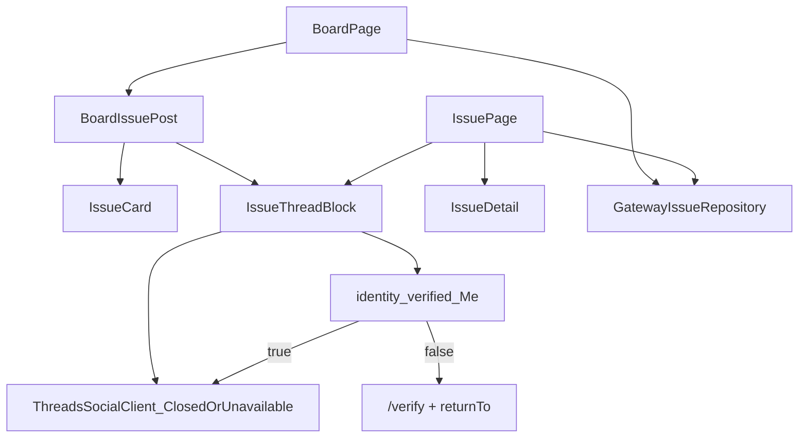

# ADMIN-THR-06 — Tech decomposition (sketch only)

## Meta

- **Key:** `ADMIN-THR-06-tech-decomposition`
- **Status:** Done (2026-09-22)
- **Depends on:** ADMIN-THR-05 · product stories THR-01…06 present
- **Blocks:** — (no execute)
- **Skill:** epic/wave sketch — **no folders, no pkg, no task README**
- **Architecture SSOT:** [threads-feed-ux](../../../architecture/threads-feed-ux/00-overview.md) · [01](../../../architecture/threads-feed-ux/01-composition-and-mounts.md) · [02](../../../architecture/threads-feed-ux/02-clients-and-write-gates.md) · [03](../../../architecture/threads-feed-ux/03-reactions-attachments-escalation.md) · [04](../../../architecture/threads-feed-ux/04-verify-and-fail-soft.md)
- **FE needs:** [ADMIN-THR-04](ADMIN-THR-04-api-requirements.md) (partial Open)

## Цель

Projected epic/wave order + ADR-lite + subtask matrices in THR-01…06 for Spa B later. **Does not** start P1.3 / pkg.

## Epic working title

`EPIC-SPA-NN-threads-feed-ux` — number TBD at execute materialize.

---

## Architecture decisions (ADR-lite, locked)

| ID | Decision | Argument (arch / verified) |
|----|----------|----------------------------|
| **D1** | `BoardIssuePost` wraps as-is `IssueCard` + `IssueThreadBlock` | Arch 00 Q1=B · 01 composition |
| **D2** | Clients **C**: Issues = gateway as-is; social = threads when Closed; verified = Identity `identity_verified` on `GET /me` | Arch 00 Q2 · 02 · ADMIN-04 Verified Issues/Me; social Open |
| **D3** | Verify UX = existing `/verify` + returnTo — **not** inline duplicate | Arch 00 Q3=A · 04 |
| **D4** | Mounts: `/board` **and** `/issue/:id` share one `IssueThreadBlock` | Arch 00 Q4=B · 01 · M143/M148 |
| **D5** | Attachments = refs + legal media floor; soft fail; **no** disable-floor control | Arch 00 Q5=A · 03 · AC-SPA-THR-06 |
| **D6** | reactions.v1 summary strip + full enabled picker; **no** invent reaction ids | Arch 00 Q6=A · 03 · M145 |
| **D7** | Escalation = visible non-dead stub; **no** invent escalate HTTP | Arch 00 Q7=A · 03 · THR-04 |
| **D8** | Progressive shell + fail-soft; **no** spa mock comments/reactions | Arch 00 Q8=A · 04 · ADMIN-04 |
| **D9** | i18n: future `threadsFeedDictionary.js` + merge in `dictionaries.js` from ADMIN-05 §L10N tables — **not created** this layer | ADMIN-05 · ESD D6 pattern |
| **D10** | Host = PH-04 `/board` + existing Issue page; **do not reopen** PH chrome stories | Arch 01 · PRODUCT-BRIEF |



### Target module sketch (execute later — **not** created here)

| Module | Role |
|--------|------|
| `src/components/threadsFeed/BoardIssuePost.jsx` | Feed row wrapper (IssueCard + thread slot) |
| `src/components/threadsFeed/IssueThreadBlock.jsx` | Shared tree / picker / composer / stub |
| `src/repositories/*` or `src/services/threadsSocial*` | Social ops **only** when Closed — else Unavailable |
| Me / write-gate consumer | Prefer `identity_verified` (cutover from `phone_verified`) |
| `src/i18n/threadsFeedDictionary.js` | `threadsFeed.*` en/et/ru + FLAT_KEYS |

---

## Wave order (P1.3 later — operator go-ahead only)

```
Wave A (optional, separate go-ahead): THR-06 clients + identity_verified cutover + fail-soft
Wave B: THR-01 mounts → THR-02 tree/composer → THR-03 reactions → THR-04 stub → THR-05 verify gate
```

Host reuse: PH-04 board; do not reopen PH chrome.

---

## Subtask matrices (pipeline IDs — projected)

> Slugs only. **No** `docs/tasks/epics/**` folders this layer (name ≠ create). Materialize at P1.3.  
> Full tables live on each story `## Субтаски`. Summary:

| Story | Tasks | ui_anchor |
|-------|-------|-----------|
| THR-01 | T01–T07 | T01 BoardIssuePost wrap |
| THR-02 | T01–T07 | T02 reply composer |
| THR-03 | T01–T07 | T02 picker layers |
| THR-04 | T01–T05 | T01 invite control |
| THR-05 | T01–T06 | T02 verify handoff |
| THR-06 | T01–T05 | — (tech_first) |

### Explicit bans (every task)

- Invent HTTP paths/fields beyond ADMIN-04 Verified / sibling Closed
- Spa mock feed / fake comments / fake reactions
- Inline verify product inside thread
- Escalate API this wave
- Reopen PH Header/Footer chrome stories
- Disable legal media floor control

---

## Acceptance

- [x] Sketch written in this file (no epic folders created)
- [x] Subtask tables on THR-01…06
- [x] INDEX ADMIN-THR-06 → Done
- [x] Explicit: **no P1.3 from this layer alone**

## TODO (layer execution)

- [x] Write sketch ADR notes in this file
- [x] Patch THR-01…06 `## Субтаски`
- [x] Do **not** create `docs/tasks/epics/**` until ordered

## Как выполнять

«Выполни ADMIN-THR-06…» — только docs sketch + story subtask tables; no epic folders; no pkg.
